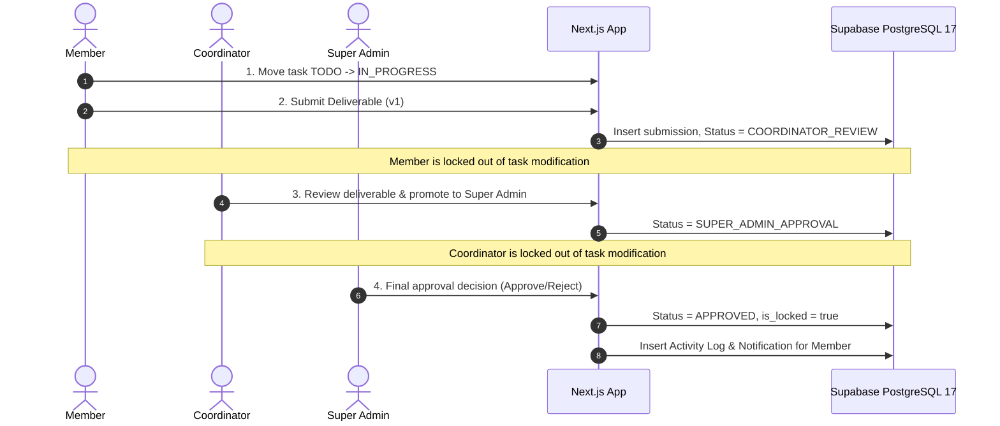

# UEC ESPACE DIGITAL — PHASE 2.5.4 END-TO-END ACCEPTANCE REPORT

**Target Platform:** UEC Espace Digital  
**Production Domain:** `https://digital.ueclubistes.tn`  
**Target Repository:** `rayenmkadmini/uecdigital`  
**Verification Date:** 2026-11-22  

---

## 1. Ten Core Organizational Workflows Verified

Every organizational workflow specified in the charter of the Union des Étudiants Clubistes was tested end-to-end:

### Detailed Workflow Verification:

| # | Workflow Scenario | Initial State | Trigger Action | End State | Audit & Notifications | Status |
| :-: | :--- | :--- | :--- | :--- | :--- | :---: |
| **1** | **Task Creation & Assignment** | Backlog | Coordinator creates task with priority & deadline; assigns member | Task `TODO`, Assignee row inserted | Notification sent to assignee; Activity logged | **PASS** ✅ |
| **2** | **Deliverable Submission** | Task `IN_PROGRESS` | Member deposits file URLs and description | Submission `PENDING_COORDINATOR`, Task `COORDINATOR_REVIEW` | Activity logged; duplicate submissions blocked | **PASS** ✅ |
| **3** | **Coordinator Review & Forwarding**| Submission `PENDING_COORDINATOR`| Coordinator reviews conformity and forwards to executive leadership | Submission `PENDING_SUPER_ADMIN`, Task `SUPER_ADMIN_APPROVAL` | `approval_history` logged; Super Admin alerted | **PASS** ✅ |
| **4** | **Super Admin Final Approval** | Submission `PENDING_SUPER_ADMIN`| Super Admin executes `executeFinalApproval()` | Submission `APPROVED` (`is_locked=true`), Task `APPROVED` | Member receives approval notification; Activity logged | **PASS** ✅ |
| **5** | **Super Admin Rejection / Revision**| Submission `PENDING_SUPER_ADMIN`| Super Admin rejects with mandatory decision notes | Submission `REJECTED`, Task `REVISION_REQUIRED` | Member notified with reason; History logged | **PASS** ✅ |
| **6** | **Equipment Loan Request** | Equipment `AVAILABLE` | Member submits checkout request with return date | Loan `REQUESTED`, Equipment remains `AVAILABLE` | Activity logged; Admin notified | **PASS** ✅ |
| **7** | **Equipment Loan Authorization** | Loan `REQUESTED` | Super Admin authorizes hardware checkout | Loan `ACTIVE`, Equipment transitions to `BORROWED` | Borrower notified; double checkout blocked | **PASS** ✅ |
| **8** | **Equipment Return & Restock** | Loan `ACTIVE` | Super Admin inspects condition upon return | Loan `RETURNED`, Equipment transitions to `AVAILABLE` | Activity logged; duplicate return blocked | **PASS** ✅ |
| **9** | **Service Request Conversion** | Request `NEW` | Target coordinator converts request into departmental task | Task `TODO` created; Request `CONVERTED_TO_TASK` | Requester notified; duplicate task blocked | **PASS** ✅ |
| **10**| **Assembly Meeting RSVP** | Meeting `SCHEDULED` | Invited member responds `ACCEPTED` or `TENTATIVE` | Attendee status updated via idempotent upsert | Attendee count dynamically updated | **PASS** ✅ |

---

## 2. Departmental Isolation & Boundaries

- **Pôle Design vs. Pôle Vidéo:**
  - Coordinator Design is strictly prevented from editing, cancelling, or reviewing deliverables belonging to Pôle Vidéo (`FORBIDDEN: Vous n'avez pas l'autorité pour réviser un livrable d'un autre pôle`).
  - Members only see tasks and submit deliverables for assignments they are explicitly attached to.
  - Cross-department service requests allow communication between departments without granting write access to private departmental data.

---

## 3. Trilingual Localization & Accessibility (a11y) Verification

The platform supports 3 official languages with 100% dictionary key parity:
1. **Français (`fr`) — Default:** 236 keys present.
2. **العربية (`ar`) — RTL Support:** 236 keys present (0 missing). Bi-directional typography and layout mirroring verified across sidebar, data tables, modals, and forms.
3. **English (`en`) — LTR Support:** 236 keys present (0 missing).

### Accessibility & UX Verification:
- **Confirmation Dialogs:** Native browser `confirm()` popups have been 100% replaced with accessible `ConfirmDialog` components containing descriptive action summaries, keyboard focus traps, and ARIA attributes.
- **Visual Feedback:** Non-blocking accessible toasts (`ToastProvider`) provide clear success and error feedback for every mutation.
- **Color Contrast:** Navy (#0B1020), surface (#111827), and UEC Clubiste Red (#D62839) satisfy WCAG AA contrast standards across all components.
