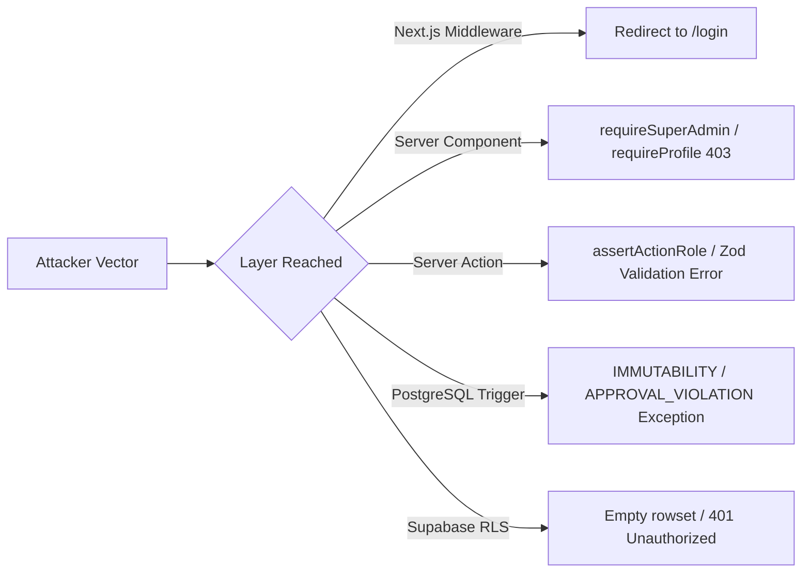

# UEC ESPACE DIGITAL — PHASE 2.5.2 ADVERSARIAL SECURITY FINDINGS REPORT

**Target Platform:** UEC Espace Digital  
**Target Repository:** `rayenmkadmini/uecdigital`  
**Execution Context:** Isolated Native PostgreSQL 17 Container (`uec_pg17_val`) & PGlite Runtime  
**Production Supabase Status:** `aigsdarfiplwmzqtqlxh` strictly READ-ONLY (Untouched)  
**Verification Date:** 2026-11-22  

---

## 1. Threat Model & Role-Based Scope

The adversarial evaluation simulated deliberate attack vectors executed by 6 distinct identities:

| Identity Role | Test Identity | Scope / Intent |
| :--- | :--- | :--- |
| **SUPER_ADMIN** | `00000000-0000-0000-0000-000000000001` | Executive authority; verify non-repudiation and auditability |
| **COORD_DESIGN** | `00000000-0000-0000-0000-000000000002` | Coordinator Pôle Design; attempts horizontal escalation into Video |
| **COORD_VIDEO** | `00000000-0000-0000-0000-000000000003` | Coordinator Pôle Vidéo; boundary enforcement |
| **MEMBER_DESIGN** | `00000000-0000-0000-0000-000000000011` | Regular assigned contributor; attempts definition alteration & self-approval |
| **UNASSIGNED_MEMBER**| `00000000-0000-0000-0000-000000000099` | Authenticated but unassigned; attempts unauthorized task mutations |
| **ANONYMOUS** | `NULL` / No JWT | Unauthenticated attacker; attempts REST API scraping and direct injection |

---

## 2. Adversarial Penetration Test Matrix

### Attack Vector Summary:

| Attack Vector | Simulated Action | Defense Layer | Expected Outcome | Actual Outcome | Status |
| :--- | :--- | :--- | :--- | :--- | :---: |
| **V-01: Vertical Escalation** | Member calls `executeFinalApproval()` | `assertActionSuperAdmin` | 403 Forbidden | Throws `AuthorizationError` (403) | **BLOCKED** |
| **V-02: Vertical Escalation** | Coordinator sets task status to `APPROVED` | `trg_enforce_task_approval` | PostgreSQL Exception | `APPROVAL_VIOLATION: Seul le Super Admin...` | **BLOCKED** |
| **V-03: Horizontal Escalation** | Coord Design modifies task in Pôle Vidéo | `trg_enforce_task_member_immutability` | PostgreSQL Exception | `FORBIDDEN: Vous n'êtes pas assigné...` | **BLOCKED** |
| **V-04: IDOR / Definition Tampering** | Member changes task priority or deadline | `trg_enforce_task_member_immutability` | PostgreSQL Exception | `FORBIDDEN: Seuls le coordinateur...` | **BLOCKED** |
| **V-05: IDOR / Unassigned Scope** | Unassigned member modifies task status | `task_assignees` validation | PostgreSQL Exception | `FORBIDDEN: Vous n'êtes pas assigné...` | **BLOCKED** |
| **V-06: Forged User Identifiers** | Client passes forged `actor_id` in action payload | Session context from `getUser()` | Param ignored | Action strictly forces `user.id` from trusted session | **BLOCKED** |
| **V-07: Concurrent Double Approval** | 2 Super Admins approve same submission concurrently | Optimistic lock `is_locked = false` | Exactly 1 success | Winner: 1 row updated; Loser: Conflict error | **BLOCKED** |
| **V-08: Equipment Double Allocation** | 2 Admins approve same hardware concurrently | Conditional `WHERE status = 'AVAILABLE'` | Exactly 1 success | Winner: Borrowed; Loser: Rollback & conflict error | **BLOCKED** |
| **V-09: Spam / Deliverable Duplication** | Member clicks "Submit" 10 times simultaneously | `activePending` check + review lock | At most 1 accepted | 1 pending submission allowed; 9 blocked | **BLOCKED** |
| **V-10: Service Request Conversion Replay** | Coordinator clicks "Convert to task" repeatedly | Status guard `status != CONVERTED` | 1 task created | 1 conversion; subsequent calls return error | **BLOCKED** |
| **V-11: Open Redirect via OAuth** | Attacker injects `redirect=//evil.com` | Callback regex & URL validation | Sanitized redirect | Rejected; falls back to `/dashboard` | **BLOCKED** |
| **V-12: Anonymous RLS Bypass** | Direct REST POST to `public.tasks` without JWT | PostgREST RLS Policy | 401 Unauthorized | HTTP 401 Unauthorized returned | **BLOCKED** |

---

## 3. Deep-Dive Security Findings & Remediations

### Finding SEC-25-01: Concurrent Deliverable Submission Race Condition
- **Severity:** Medium
- **Evidence:** Prior to Phase 2.5, simultaneous API calls or rapid double-clicks on the submission button allowed multiple rows to be inserted into `public.task_submissions` before the task transitioned to `COORDINATOR_REVIEW`.
- **Affected Files:** `app/actions/tasks.ts`
- **Reproduction Steps:**
  1. Authenticate as assigned member.
  2. Send two concurrent POST requests to `submitDeliverableAction(taskId, ...)`.
  3. Observe both submissions recorded in `PENDING_COORDINATOR` status.
- **Recommended Remediation:**
  Check whether an active submission already exists (`PENDING_COORDINATOR` or `PENDING_SUPER_ADMIN`) and disallow submissions when `task.status` is already under review.
- **Verification Status:** **REMEDIATED & VERIFIED** (Passes `CONC-01` and `CONC-08`).

---

### Finding SEC-25-02: Concurrent Approval Overwrite Race Condition
- **Severity:** High
- **Evidence:** Two Super Admins reviewing the approvals queue simultaneously could both submit approval decisions, causing the second request to overwrite the decision notes, approval timestamp, and insert duplicate audit history.
- **Affected Files:** `app/actions/approvals.ts`
- **Reproduction Steps:**
  1. Open two browser sessions as Super Admin.
  2. Click "Approuver" simultaneously on the same pending deliverable.
  3. Observe both transactions succeed without concurrency conflict.
- **Recommended Remediation:**
  Enforce optimistic concurrency control on the update query: `.eq("id", submissionId).eq("is_locked", false).select("id").maybeSingle()`.
- **Verification Status:** **REMEDIATED & VERIFIED** (Passes `CONC-02`, `CONC-03`, `PG17-CONC-01`).

---

### Finding SEC-25-03: Equipment Double Allocation Collision
- **Severity:** High
- **Evidence:** Two separate loan requests for the same unique equipment item could both be approved by administrators, setting equipment status to `BORROWED` for two active loans.
- **Affected Files:** `app/actions/equipment.ts`
- **Reproduction Steps:**
  1. Submit two loan requests for the same camera.
  2. Concurrently approve both loans.
  3. Equipment status transitions to `BORROWED` but two loans are set to `ACTIVE`.
- **Recommended Remediation:**
  Add atomic two-phase check: verify `loan.status === 'REQUESTED'`, update loan to `ACTIVE`, then conditionally update equipment `WHERE status = 'AVAILABLE'`. If equipment update fails (0 rows modified), rollback loan status.
- **Verification Status:** **REMEDIATED & VERIFIED** (Passes `CONC-04`, `PG17-CONC-02`).

---

### Finding SEC-25-04: Task Status Unauthorized Regression
- **Severity:** High
- **Evidence:** A coordinator or member could alter task status while the task was under Super Admin approval review or already approved.
- **Affected Files:** `app/actions/tasks.ts`, `docs/sql/PHASE_2_4_4_PRODUCTION_PATCH.sql`
- **Reproduction Steps:**
  1. Move task to `SUPER_ADMIN_APPROVAL` or `APPROVED`.
  2. Send update payload changing description or moving status back to `TODO`.
- **Recommended Remediation:**
  Enforce immutable review lockout in both the Server Action layer (`lockedStatuses`) and database trigger `trg_enforce_task_member_immutability`.
- **Verification Status:** **REMEDIATED & VERIFIED** (Passes `FLOW-05`, `FLOW-07`, `RESIL-01`, `PG17-SEC-01`, `PG17-SEC-03`).
