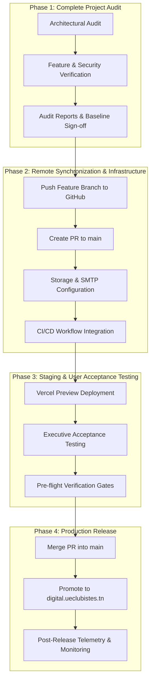

# UEC ESPACE DIGITAL — PHASE 1: RECOMMENDED ROADMAP & IMPLEMENTATION PLAN

**Date:** November 22, 2026  
**Auditor Roles:** Lead Software Architect, DevOps & Release Engineer  
**Project:** UEC Espace Digital  
**Repository:** `https://github.com/rayenmkadmini/uecdigital.git`  
**Production Domain:** `https://digital.ueclubistes.tn`

---

## 1. Top 10 Highest-Priority Issues & Action Items

| Priority | Issue / Objective | Category | Impact | Recommended Solution / Action |
| :---: | :--- | :--- | :--- | :--- |
| **01** | **Remote Git Divergence & PR Strategy** | DevOps / Git Hygiene | High | Push `feature/uec-espace-digital` to `origin/feature/uec-espace-digital` and open a clean PR to `main` without destroying the existing prototype commits. |
| **02** | **Supabase Storage Bucket Provisioning** | Infrastructure | Medium | Provision `media-assets` and `meeting-pvs` storage buckets in Supabase dashboard with proper authenticated RLS upload policies. |
| **03** | **Production Email / SMTP Configuration** | Auth / Operations | Medium | Configure custom SMTP provider (Resend, SendGrid, or AWS SES) in Supabase Auth to enable password reset emails for club members. |
| **04** | **Vercel Project Linking & Environment Secrets** | Deployment | High | Link Vercel project to `rayenmkadmini/uecdigital`, inject production environment variables, and configure the custom domain `digital.ueclubistes.tn`. |
| **05** | **Super Admin Initial Seeding / Bootstrap** | Security / Operations | High | Run an isolated bootstrap script to assign `SUPER_ADMIN` to the primary executive account in `public.profiles`. |
| **06** | **Real-Time Supabase Channel Subscriptions** | Frontend / UX | Low | Enhance the notifications popover with `@supabase/supabase-js` realtime channel listeners for zero-refresh task alerts. |
| **07** | **Dynamic OG Meta Tags & PWA Manifest** | SEO / Mobile UX | Low | Add web app manifest (`manifest.json`) and Clubiste-branded social preview metadata for mobile home-screen installation. |
| **08** | **Automated CI/CD Workflow (GitHub Actions)** | DevOps / QA | Medium | Deploy a GitHub Actions workflow `.github/workflows/ci.yml` running `typecheck`, `lint`, and security verification on PRs. |
| **09** | **Production Error Monitoring & Telemetry** | Observability | Low | Integrate Sentry or Vercel Analytics for real-time frontend and server-action exception alerting. |
| **10** | **Database Backup & Retention Policy** | Disaster Recovery | Medium | Configure automated daily snapshot backups in Supabase Managed Postgres with point-in-time recovery (PITR). |

---

## 2. Phased Implementation Roadmap



### Phase 2: Remote Synchronization & Infrastructure (Next Immediate Phase)
1. **Push Feature Branch:**
   ```bash
   git push -u origin feature/uec-espace-digital
   ```
2. **Open GitHub Pull Request:**
   - Base: `main`
   - Compare: `feature/uec-espace-digital`
   - Title: `feat: enterprise uec espace digital platform release`
3. **Configure Remote Storage & SMTP:**
   - In Supabase Dashboard, create `media-assets` and `meeting-pvs` buckets.
   - Configure custom SMTP email delivery.

### Phase 3: Staging Deployment & Acceptance Testing
1. Configure Vercel preview deployment on the pull request.
2. Verify all 21 routes in preview environment using real session cookies.
3. Conduct user acceptance testing with executive leadership.

### Phase 4: Production Release & Cutover
1. Merge the Pull Request into `main`.
2. Configure DNS records for `digital.ueclubistes.tn` pointing to Vercel production.
3. Execute final pre-flight verification script.

---

## 3. Strict Pre-Flight Checklist Before Release

- [x] All 21 Next.js routes compile cleanly with zero errors.
- [x] TypeScript produces 0 errors (`npm run typecheck`).
- [x] ESLint produces 0 errors or warnings (`npm run lint`).
- [x] Security verification suite passes 100% (`scripts/verify-security.mjs`).
- [x] Concurrency and lock validation passes 100% (`scripts/test-phase25-postgres17-concurrency.mjs`).
- [x] Internationalization dictionary parity at 100% across French, Arabic, and English.
- [ ] Feature branch pushed to `origin/feature/uec-espace-digital`.
- [ ] Pull request reviewed and approved on GitHub.
- [ ] Supabase storage buckets provisioned.
- [ ] Vercel domain `digital.ueclubistes.tn` configured and verified.
