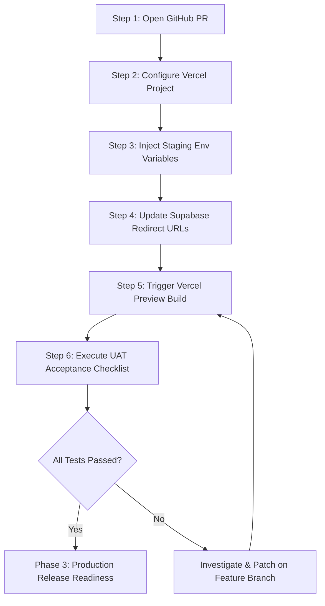

# UEC ESPACE DIGITAL — PHASE 2: STAGING DEPLOYMENT PLAN

**Target Branch:** `feature/uec-espace-digital`  
**Official Repository:** `https://github.com/rayenmkadmini/uecdigital.git`  
**Staging Host:** Vercel (Preview Deployment)  
**Target Database:** Supabase (`aigsdarfiplwmzqtqlxh`)

---

## 1. Staging Objective & Principles

The primary objective of the Staging phase is to validate the full UEC Espace Digital platform in an authentic web hosting environment (Vercel edge network) with live browser cookies, real network latency, and real database roundtrips, prior to public deployment on `digital.ueclubistes.tn`.

### Core Staging Invariants
1. **Zero Production Cutover:** The custom production domain `digital.ueclubistes.tn` remains disconnected until staging acceptance is fully signed off.
2. **Safe Preview Isolation:** The staging application will run on an isolated Vercel preview domain (`https://uecdigital-git-feature-uec-espace-digital-*.vercel.app`).
3. **Database Guardrails:** Staging uses the existing schema and tables in Supabase without running disruptive DDL mutations.

---

## 2. Step-by-Step Staging Implementation Procedure

### Step 1: Open Staging Pull Request on GitHub
- Open a Pull Request from `feature/uec-espace-digital` targeting `main`.
- URL: `https://github.com/rayenmkadmini/uecdigital/pull/new/feature/uec-espace-digital`
- Title: `feat: enterprise uec espace digital platform release candidate`
- Purpose: Activates Vercel automatic preview deployment and status checks.

### Step 2: Vercel Project Linking
- Connect the GitHub repository `rayenmkadmini/uecdigital` in the Vercel Dashboard.
- Set Framework Preset: `Next.js`.
- Build Command: `npm run build`.
- Output Directory: `.next`.
- Install Command: `npm install`.

### Step 3: Configure Environment Variables on Vercel
In Vercel Project Settings > Environment Variables, assign to **Preview** and **Development** environments:
- `NEXT_PUBLIC_SUPABASE_URL`: `https://aigsdarfiplwmzqtqlxh.supabase.co`
- `NEXT_PUBLIC_SUPABASE_ANON_KEY`: *(From Supabase Project Settings > API)*
- `NEXT_PUBLIC_SITE_URL`: Set dynamically to the Vercel preview URL or left omitted for dynamic origin detection.

### Step 4: Configure Supabase Authentication Redirects
In Supabase Dashboard > Authentication > URL Configuration:
- Add `https://*.vercel.app/**` to **Redirect URLs**.
- Add `https://*.vercel.app/reset-password` to **Redirect URLs**.
- Add `https://*.vercel.app/auth/callback` to **Redirect URLs**.

### Step 5: Trigger & Inspect Staging Build
- Allow Vercel to build and deploy the PR.
- Verify build logs:
  - Zero TypeScript compile errors.
  - Zero ESLint warnings.
  - All 21 routes generated with expected static/dynamic status.
  - Edge middleware bundled correctly.

---

## 3. Staging User Acceptance Testing (UAT) Checklist

| Test ID | Scenario | Expected Behavior | Verification Method |
| :---: | :--- | :--- | :--- |
| **UAT-01** | **Root Redirection** | Unauthenticated user hitting `/` is redirected to `/login`. | Browser check on Vercel preview URL |
| **UAT-02** | **Member Login** | Valid credentials establish secure session cookies and redirect to `/dashboard`. | Browser login test |
| **UAT-03** | **Trilingual Toggle** | Switching language to Arabic dynamically sets `dir="rtl"` and translates all UI strings. | Header language selector |
| **UAT-04** | **Pôle Task Creation** | Coordinator creates a task; task appears immediately on Kanban board. | Tasks view |
| **UAT-05** | **Deliverable Submission** | Member submits file URL and notes; status moves to `COORDINATOR_REVIEW`. | Member dashboard & modal |
| **UAT-06** | **2-Tier Approval** | Coordinator approves $\to$ moves to `SUPER_ADMIN_APPROVAL` $\to$ Super Admin approves $\to$ `APPROVED`. | Approvals view |
| **UAT-07** | **Media Asset Upload** | Member uploads image to `espace-digital-media` bucket; asset appears in gallery. | Media library view |
| **UAT-08** | **Equipment Loan Booking** | Member requests camera loan; item is reserved; Super Admin confirms loan. | Equipment desk view |
| **UAT-09** | **Password Recovery** | Forgot password dispatches reset email; reset page updates password successfully. | Recovery flow |
| **UAT-10** | **RBAC Route Shielding** | Regular member attempting to access `/dashboard/users` receives 403 / redirect. | Direct URL navigation |

---

## 4. Rollback & Abort Criteria

The staging deployment must be paused and investigated if:
1. **Cookie Session Failure:** Supabase auth cookies are rejected due to domain/SameSite mismatch on `.vercel.app`.
2. **RLS Denial on Valid Roles:** Authenticated members are unexpectedly blocked from their assigned department data.
3. **CSP Blocking:** Content Security Policy blocks necessary Supabase API endpoints or fonts.
4. **Build Failure:** Any route fails to render server-side during the build step.
