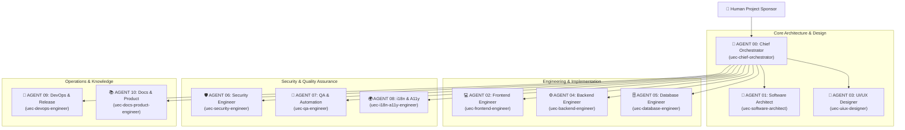

# UEC Espace Digital — AI Agent Engineering Team Architecture

**Project:** UEC Espace Digital (*Union des Étudiants Clubistes — Depuis 2021*)  
**Repository:** `rayenmkadmini/uec`  
**Location:** `D:\uecdegital`  
**Branch:** `feature/uec-espace-digital`  
**Native Engine:** Antigravity Subagent Runtime & Workspace Customization System

---

## 1. Architectural Overview

The UEC AI Engineering Team is structured as a hierarchical, multi-agent autonomous engineering organization. It models a full-stack, enterprise-grade development division tailored specifically to the UEC digital platform requirements: Next.js 15 App Router, React 19, TypeScript strict mode, Supabase (PostgreSQL 17, RLS, Storage), trilingual localization (FR, AR RTL, EN), and 2-tier approval workflows.



---

## 2. Team Directory Structure

The agents are installed project-locally under `.agents/` adhering to Antigravity's native workspace customization discovery specification:

```
D:\uecdegital\
├── .agents\
│   ├── AGENTS.md                                   # Workspace-wide operational rules & safety invariants
│   ├── team-manifest.json                          # Central team roster & tool access policies
│   └── agents\
│       ├── uec-chief-orchestrator\agent.md         # AGENT 00: Chief Orchestrator
│       ├── uec-software-architect\agent.md         # AGENT 01: Software Architect
│       ├── uec-frontend-engineer\agent.md          # AGENT 02: Frontend Engineer
│       ├── uec-uiux-designer\agent.md              # AGENT 03: UI/UX Designer
│       ├── uec-backend-engineer\agent.md           # AGENT 04: Backend Engineer
│       ├── uec-database-engineer\agent.md          # AGENT 05: Database & Supabase Engineer
│       ├── uec-security-engineer\agent.md          # AGENT 06: Security Engineer
│       ├── uec-qa-engineer\agent.md                # AGENT 07: QA & Automation Engineer
│       ├── uec-i18n-a11y-engineer\agent.md         # AGENT 08: i18n & Accessibility Engineer
│       ├── uec-devops-engineer\agent.md            # AGENT 09: DevOps & Release Engineer
│       └── uec-docs-product-engineer\agent.md      # AGENT 10: Documentation & Product Engineer
```

---

## 3. Communication & Execution Mechanics

Antigravity operates through two coordinated layers:
1. **File-Based Discovery (`.agents/agents/*/agent.md`)**:
   - Persisted in Git repository.
   - Provides immutable specifications, boundaries, tool capabilities, and persona instructions.
2. **Dynamic Runtime Registration (`define_subagent` & `invoke_subagent`)**:
   - Registers typed subagent definitions directly in the active Antigravity session.
   - Spawns autonomous asynchronous worker instances with isolated conversation contexts.
   - Workers execute shell commands, read/write files, and notify the parent orchestrator upon task completion via reactive wakeups.
