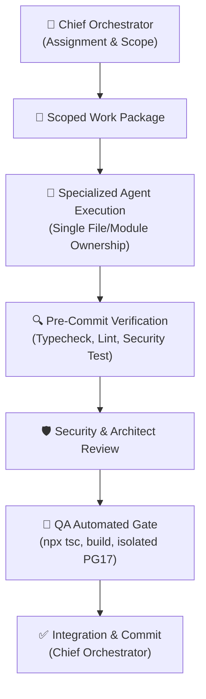

# UEC Espace Digital — AI Agent Engineering Team Collaboration Rules

**Project:** UEC Espace Digital (*Union des Étudiants Clubistes — Depuis 2021*)  
**Version:** 1.0.0  
**Authority:** Chief Orchestrator (`uec-chief-orchestrator`)

---

## 1. Fundamental Collaboration Principles

To maintain code excellence, prevent merge conflicts, and avoid regression loops across our autonomous multi-agent engineering team, all agents must adhere to the following collaboration protocol.

---

## 2. File & Module Ownership Matrix

No two agents may edit the same source file concurrently. Ownership is assigned as follows:

| Domain / Subsystem | Primary Responsible Agent | Supporting Reviewer |
|:---|:---|:---|
| **`app/dashboard/*` UI Pages** | `uec-frontend-engineer` | `uec-uiux-designer` |
| **`components/*` Client Views** | `uec-frontend-engineer` | `uec-uiux-designer` |
| **`lib/data/*.ts` Data Layers** | `uec-backend-engineer` | `uec-software-architect` |
| **`app/actions/*.ts` Server Actions** | `uec-backend-engineer` | `uec-security-engineer` |
| **`supabase/` & PostgreSQL Schema** | `uec-database-engineer` | `uec-security-engineer` |
| **`lib/auth/*` & Security Guards** | `uec-security-engineer` | `uec-software-architect` |
| **`scripts/*` Test Suites** | `uec-qa-engineer` | `uec-security-engineer` |
| **`messages/*.json` Translations** | `uec-i18n-a11y-engineer` | `uec-frontend-engineer` |
| **`docs/*` Technical Records** | `uec-docs-product-engineer` | `uec-chief-orchestrator` |
| **`package.json`, Next / Vercel Config** | `uec-devops-engineer` | `uec-software-architect` |

---

## 3. Pre-Integration Verification Protocol

Before any completed work package is accepted by the Chief Orchestrator:
1. **Type Safety**: `npx tsc --noEmit` must return 0 errors.
2. **Linting**: `npm run lint` must return 0 errors and 0 warnings.
3. **Route Build**: `npm run build` must compile all 21 routes without runtime exceptions.
4. **Security Certification**: `node scripts/verify-security.mjs` must pass 23/23 tests (100%).
5. **Runtime SQL Compatibility**: `node scripts/test-phase242-isolated.mjs` must pass 54/54 tests (100%).

---

## 4. Conflict Resolution & Communication Rules

- If an agent identifies a defect or missing requirement outside its ownership domain, it must report the issue to the Chief Orchestrator via `send_message` rather than modifying the unowned file directly.
- The Chief Orchestrator resolves interface disagreements between frontend and backend contracts by giving precedence to strict type definitions in `types/database.ts` and `lib/data/*.ts`.
- All Git commits are signed and integrated exclusively by the Chief Orchestrator with conventional commit messages.
