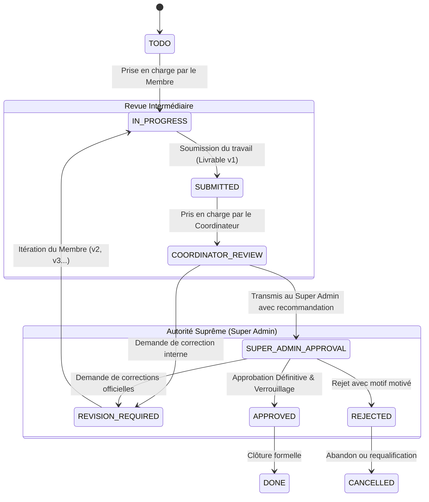

# WORKFLOW DE SOUMISSION & APPROBATION STRICTE — UEC ESPACE DIGITAL
**Architecture du Cœur de Validation des Livrables**  
**Organisation :** Union des Étudiants Clubistes (UEC)  
**Règle Fondamentale :** LE SUPER ADMIN EST L'UNIQUE AUTORITÉ D'APPROBATION FINALE.

---

## 1. Vue d'Ensemble du Flux Opérationnel

---

## 2. Étapes Détaillées & Protocoles

### Étape 1 : Soumission par le Membre (`SUBMITTED`)
1. Le membre finalise le travail associé à sa tâche assignée.
2. Il téléverse les livrables dans la médiathèque privée sécurisée (`task_attachments` / `task_submissions.file_urls`).
3. Il renseigne un intitulé clair, une description de la version et dépose la soumission.
4. **Comportement Base de Données :**
   - Création d'une ligne dans `task_submissions` avec `version = (SELECT COALESCE(MAX(version),0) + 1 FROM task_submissions WHERE task_id = :id)`.
   - Statut de la soumission : `PENDING_COORDINATOR`.
   - Statut de la tâche synchronisé : `SUBMITTED`.
   - Insertion dans `approval_history` (`action = 'SUBMITTED'`).

### Étape 2 : Revue Intermédiaire par le Coordinateur (`COORDINATOR_REVIEW`)
1. Le Coordinateur du pôle reçoit une alerte dans son tableau de bord.
2. Il examine la conformité technique et visuelle du travail.
3. **Deux issues exclusives :**
   - **Cas A — Corrections Internes Nécessaires :**
     - Le Coordinateur saisit ses remarques (`coordinateur_notes`).
     - Statut de la soumission passe à `REVISION_REQUIRED`.
     - Statut de la tâche repasse à `REVISION_REQUIRED`.
     - Historisation : `action = 'COORDINATOR_REQUESTED_REVISION'`.
     - Le membre est notifié pour itérer sur une version supérieure ($v+1$).
   - **Cas B — Livrable Conforme :**
     - Le Coordinateur valide techniquement et transmet la soumission à la direction.
     - Statut de la soumission passe à `PENDING_SUPER_ADMIN`.
     - Statut de la tâche passe à `SUPER_ADMIN_APPROVAL`.
     - Historisation : `action = 'COORDINATOR_FORWARDED'`.
4. **Verrou de Sécurité :**  
   Toute tentative du Coordinateur de définir directement le statut à `APPROVED` est rejetée par trigger PostgreSQL avec l'erreur :  
   `ACCESS_DENIED: Seul le Super Admin peut approuver définitivement un livrable.`

### Étape 3 : Décision Souveraine du Super Admin (`SUPER_ADMIN_APPROVAL`)
Le Super Admin dispose d'une vue centralisée : le **Centre d'Approbation Officiel** (`ApprovalCenter`).
Il visualise :
- Le contexte complet : Projet, Pôle, Tâche, Membre exécutant, Coordinateur référent.
- Les fichiers soumis et leur historique de versions comparables.
- Les notes d'évaluation du Coordinateur.

**Actions Possibles du Super Admin :**
1. **`APPROUVER` (Approbation Finale) :**
   - Enregistrement de l'ID du Super Admin (`super_admin_id = auth.uid()`).
   - Horodatage certifié (`approved_by_super_admin_at = now()`).
   - Verrouillage immuable de la version (`is_locked = true`).
   - Statut de la soumission $\to$ `APPROVED`.
   - Statut de la tâche $\to$ `APPROVED` (puis `DONE`).
   - Historisation $\to$ `SUPER_ADMIN_APPROVED`.
   - Notification de félicitations au membre et au coordinateur.

2. **`DEMANDE DE RÉVISION` :**
   - Motif précis obligatoire (`super_admin_notes`).
   - Statut $\to$ `REVISION_REQUIRED`.
   - Historisation $\to$ `SUPER_ADMIN_REQUESTED_REVISION`.
   - La soumission courante reste archivée en lecture seule, le membre doit produire la version suivante.

3. **`REJETER` :**
   - Justification de refus obligatoire (`decision_reason`).
   - Statut $\to$ `REJECTED`.
   - Historisation $\to$ `SUPER_ADMIN_REJECTED`.
   - Tâche clôturée en rejet.

---

## 3. Immuabilité & Sécurité des Données Approuvées

- Dès qu'une soumission reçoit le statut `APPROVED`, elle devient **strictement immuable**.
- Aucune mise à jour de fichier ou de description n'est autorisée sur une version verrouillée (`is_locked = true`).
- Si une modification ultérieure est nécessaire, elle impose la création formelle d'une nouvelle version ($v+1$) soumise à l'intégralité du cycle de validation.
