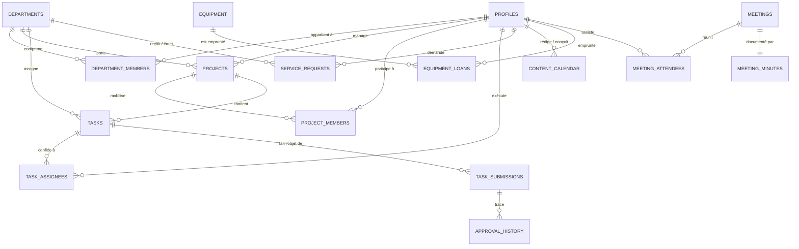

# SPÉCIFICATION DU SCHÉMA DE BASE DE DONNÉES — UEC ESPACE DIGITAL
**Plateforme de Gestion du Département Digital de l'Union des Étudiants Clubistes**  
**SGBD :** PostgreSQL 17.12 (Supabase)  
**Projet :** `aigsdarfiplwmzqtqlxh` (`uec digital`)  
**Convention de Nommage :** Snake_case, clés primaires UUID v4, contraintes explicites de clés étrangères et intégrité référentielle, indexation systématique des clés et filtres critiques.

---

## 1. Schéma Relationnel & Tables Principales

---

## 2. Dictionnaire des Données

### Module 1 : Authentification & Utilisateurs

#### `public.profiles`
Stocke l'identité et les autorisations de chaque compte lié à `auth.users`.
- `id` (UUID, PK) : Référence `auth.users(id)` ON DELETE CASCADE.
- `email` (TEXT, NOT NULL, UNIQUE) : Adresse email officielle.
- `full_name` (TEXT, NOT NULL) : Nom complet du membre.
- `avatar_url` (TEXT) : URL de l'avatar.
- `role` (TEXT, NOT NULL, DEFAULT 'MEMBER') : Valeurs autorisées : `'SUPER_ADMIN'`, `'COORDINATOR'`, `'MEMBER'`.
- `is_active` (BOOLEAN, NOT NULL, DEFAULT true) : Statut d'activation du compte.
- `phone` (TEXT) : Numéro de téléphone.
- `bio` (TEXT) : Présentation succincte ou compétences.
- `created_at` (TIMESTAMPTZ, NOT NULL, DEFAULT now()).
- `updated_at` (TIMESTAMPTZ, NOT NULL, DEFAULT now()).

#### `public.departments`
Représente les 6 équipes spécialisées initiales et configurables.
- `id` (UUID, PK, DEFAULT gen_random_uuid()).
- `name` (TEXT, NOT NULL, UNIQUE) : Nom du pôle (ex: "Design & Branding").
- `code` (TEXT, NOT NULL, UNIQUE) : Code clé (ex: "DESIGN", "VIDEO", "WEB", "STRATEGY", "SOCIAL_MEDIA", "INNOVATION").
- `description` (TEXT) : Objectifs et missions du pôle.
- `icon` (TEXT, NOT NULL, DEFAULT 'folder') : Identifiant d'icône Lucide.
- `color` (TEXT, NOT NULL, DEFAULT '#2563EB') : Code hexadécimal couleur du pôle.
- `coordinator_id` (UUID) : Référence `public.profiles(id)` ON DELETE SET NULL.
- `is_active` (BOOLEAN, NOT NULL, DEFAULT true).
- `created_at` (TIMESTAMPTZ, NOT NULL, DEFAULT now()).
- `updated_at` (TIMESTAMPTZ, NOT NULL, DEFAULT now()).

#### `public.department_members`
Association n-n entre membres et départements.
- `id` (UUID, PK, DEFAULT gen_random_uuid()).
- `department_id` (UUID, NOT NULL) : Référence `public.departments(id)` ON DELETE CASCADE.
- `user_id` (UUID, NOT NULL) : Référence `public.profiles(id)` ON DELETE CASCADE.
- `joined_at` (TIMESTAMPTZ, NOT NULL, DEFAULT now()).
- *Contrainte d'unicité :* `UNIQUE (department_id, user_id)`.

#### `public.user_preferences`
Préférences d'accessibilité, thème et notifications de l'utilisateur.
- `user_id` (UUID, PK) : Référence `public.profiles(id)` ON DELETE CASCADE.
- `language` (TEXT, NOT NULL, DEFAULT 'fr') : `'fr'`, `'ar'`, `'en'`.
- `theme` (TEXT, NOT NULL, DEFAULT 'dark') : `'dark'`, `'light'`, `'system'`.
- `email_notifications` (BOOLEAN, NOT NULL, DEFAULT true).
- `push_notifications` (BOOLEAN, NOT NULL, DEFAULT true).
- `updated_at` (TIMESTAMPTZ, NOT NULL, DEFAULT now()).

---

### Module 2 : Gestion des Projets

#### `public.projects`
Projets numériques portés par les pôles.
- `id` (UUID, PK, DEFAULT gen_random_uuid()).
- `code` (TEXT, NOT NULL, UNIQUE) : Code projet court (ex: "PRJ-2026-001").
- `title` (TEXT, NOT NULL) : Intitulé du projet.
- `description` (TEXT) : Cahier des charges ou description.
- `department_id` (UUID, NOT NULL) : Référence `public.departments(id)` ON DELETE RESTRICT.
- `manager_id` (UUID) : Référence `public.profiles(id)` ON DELETE SET NULL.
- `status` (TEXT, NOT NULL, DEFAULT 'PLANNING') : `'PLANNING'`, `'ACTIVE'`, `'ON_HOLD'`, `'IN_REVIEW'`, `'COMPLETED'`, `'CANCELLED'`.
- `priority` (TEXT, NOT NULL, DEFAULT 'MEDIUM') : `'LOW'`, `'MEDIUM'`, `'HIGH'`, `'CRITICAL'`.
- `start_date` (DATE).
- `deadline` (DATE).
- `progress` (INTEGER, NOT NULL, DEFAULT 0) : Pourcentage de 0 à 100.
- `created_by` (UUID) : Référence `public.profiles(id)` ON DELETE SET NULL.
- `created_at` (TIMESTAMPTZ, NOT NULL, DEFAULT now()).
- `updated_at` (TIMESTAMPTZ, NOT NULL, DEFAULT now()).

#### `public.project_members`
Affectation des membres opérationnels aux projets.
- `id` (UUID, PK, DEFAULT gen_random_uuid()).
- `project_id` (UUID, NOT NULL) : Référence `public.projects(id)` ON DELETE CASCADE.
- `user_id` (UUID, NOT NULL) : Référence `public.profiles(id)` ON DELETE CASCADE.
- `role_in_project` (TEXT, DEFAULT 'CONTRIBUTOR').
- `assigned_at` (TIMESTAMPTZ, NOT NULL, DEFAULT now()).
- *Contrainte d'unicité :* `UNIQUE (project_id, user_id)`.

---

### Module 3 : Tâches, Assignations & Workflow de Soumission

#### `public.tasks`
Tâches unitaires pilotées dans les vues Kanban et tableaux.
- `id` (UUID, PK, DEFAULT gen_random_uuid()).
- `project_id` (UUID) : Référence `public.projects(id)` ON DELETE CASCADE.
- `department_id` (UUID, NOT NULL) : Référence `public.departments(id)` ON DELETE RESTRICT.
- `title` (TEXT, NOT NULL) : Titre de la tâche.
- `description` (TEXT) : Instructions détaillées.
- `acceptance_criteria` (TEXT) : Critères de validation attendus.
- `priority` (TEXT, NOT NULL, DEFAULT 'MEDIUM') : `'LOW'`, `'MEDIUM'`, `'HIGH'`, `'CRITICAL'`.
- `status` (TEXT, NOT NULL, DEFAULT 'TODO') : 
  `'BACKLOG'`, `'TODO'`, `'IN_PROGRESS'`, `'SUBMITTED'`, `'COORDINATOR_REVIEW'`, `'SUPER_ADMIN_APPROVAL'`, `'REVISION_REQUIRED'`, `'APPROVED'`, `'DONE'`, `'CANCELLED'`.
- `start_date` (DATE).
- `deadline` (TIMESTAMPTZ).
- `created_by` (UUID) : Référence `public.profiles(id)` ON DELETE SET NULL.
- `coordinator_id` (UUID) : Référence `public.profiles(id)` ON DELETE SET NULL.
- `created_at` (TIMESTAMPTZ, NOT NULL, DEFAULT now()).
- `updated_at` (TIMESTAMPTZ, NOT NULL, DEFAULT now()).

#### `public.task_assignees`
- `id` (UUID, PK, DEFAULT gen_random_uuid()).
- `task_id` (UUID, NOT NULL) : Référence `public.tasks(id)` ON DELETE CASCADE.
- `user_id` (UUID, NOT NULL) : Référence `public.profiles(id)` ON DELETE CASCADE.
- `assigned_at` (TIMESTAMPTZ, NOT NULL, DEFAULT now()).
- *Contrainte d'unicité :* `UNIQUE (task_id, user_id)`.

#### `public.task_comments`
Commentaires et échanges sur la tâche.
- `id` (UUID, PK, DEFAULT gen_random_uuid()).
- `task_id` (UUID, NOT NULL) : Référence `public.tasks(id)` ON DELETE CASCADE.
- `user_id` (UUID, NOT NULL) : Référence `public.profiles(id)` ON DELETE CASCADE.
- `content` (TEXT, NOT NULL) : Corps du message.
- `created_at` (TIMESTAMPTZ, NOT NULL, DEFAULT now()).
- `updated_at` (TIMESTAMPTZ, NOT NULL, DEFAULT now()).

#### `public.task_attachments`
Fichiers d'instructions ou ressources associées à la tâche.
- `id` (UUID, PK, DEFAULT gen_random_uuid()).
- `task_id` (UUID, NOT NULL) : Référence `public.tasks(id)` ON DELETE CASCADE.
- `file_name` (TEXT, NOT NULL).
- `file_path` (TEXT, NOT NULL).
- `file_size` (BIGINT, NOT NULL).
- `mime_type` (TEXT).
- `uploaded_by` (UUID, NOT NULL) : Référence `public.profiles(id)` ON DELETE CASCADE.
- `created_at` (TIMESTAMPTZ, NOT NULL, DEFAULT now()).

#### `public.task_submissions`
Livrables déposés par les membres pour examen et validation.
- `id` (UUID, PK, DEFAULT gen_random_uuid()).
- `task_id` (UUID, NOT NULL) : Référence `public.tasks(id)` ON DELETE CASCADE.
- `submitted_by` (UUID, NOT NULL) : Référence `public.profiles(id)` ON DELETE CASCADE.
- `version` (INTEGER, NOT NULL, DEFAULT 1) : Numéro séquentiel de version (v1, v2...).
- `title` (TEXT, NOT NULL) : Intitulé de la soumission.
- `description` (TEXT, NOT NULL) : Notes de livraison.
- `file_urls` (JSONB, DEFAULT '[]'::jsonb) : Liste des fichiers rattachés.
- `status` (TEXT, NOT NULL, DEFAULT 'PENDING_COORDINATOR') :
  `'PENDING_COORDINATOR'`, `'PENDING_SUPER_ADMIN'`, `'APPROVED'`, `'REVISION_REQUIRED'`, `'REJECTED'`.
- `coordinateur_notes` (TEXT) : Avis ou remarques du coordinateur.
- `reviewed_by_coordinator_at` (TIMESTAMPTZ).
- `coordinator_id` (UUID) : Référence `public.profiles(id)` ON DELETE SET NULL.
- `super_admin_notes` (TEXT) : Remarques ou motif du Super Admin.
- `approved_by_super_admin_at` (TIMESTAMPTZ).
- `super_admin_id` (UUID) : Référence `public.profiles(id)` ON DELETE SET NULL.
- `is_locked` (BOOLEAN, NOT NULL, DEFAULT false) : Verrouillage strict en écriture après décision.
- `created_at` (TIMESTAMPTZ, NOT NULL, DEFAULT now()).
- `updated_at` (TIMESTAMPTZ, NOT NULL, DEFAULT now()).
- *Contrainte d'unicité :* `UNIQUE (task_id, version)`.

#### `public.approval_history`
Historique d'audit légal et immuable des approbations, révisions et rejets.
- `id` (UUID, PK, DEFAULT gen_random_uuid()).
- `submission_id` (UUID, NOT NULL) : Référence `public.task_submissions(id)` ON DELETE CASCADE.
- `task_id` (UUID, NOT NULL) : Référence `public.tasks(id)` ON DELETE CASCADE.
- `actor_id` (UUID, NOT NULL) : Référence `public.profiles(id)` ON DELETE CASCADE.
- `action` (TEXT, NOT NULL) : 
  `'SUBMITTED'`, `'COORDINATOR_FORWARDED'`, `'COORDINATOR_REQUESTED_REVISION'`, `'SUPER_ADMIN_APPROVED'`, `'SUPER_ADMIN_REJECTED'`, `'SUPER_ADMIN_REQUESTED_REVISION'`.
- `decision_reason` (TEXT) : Explication obligatoire pour rejet ou révision.
- `created_at` (TIMESTAMPTZ, NOT NULL, DEFAULT now()).

---

### Module 4 : Centre de Requêtes Internes

#### `public.service_requests`
Demandes de services inter-pôles.
- `id` (UUID, PK, DEFAULT gen_random_uuid()).
- `code` (TEXT, NOT NULL, UNIQUE) : Code requête (ex: "REQ-2026-001").
- `title` (TEXT, NOT NULL).
- `description` (TEXT, NOT NULL).
- `category` (TEXT, NOT NULL) :
  `'DESIGN_REQUEST'`, `'VIDEO_REQUEST'`, `'PHOTOGRAPHY_REQUEST'`, `'DEVELOPMENT_REQUEST'`, `'TECHNICAL_SUPPORT'`, `'DIGITAL_STRATEGY'`, `'OTHER'`.
- `requesting_department_id` (UUID) : Référence `public.departments(id)` ON DELETE SET NULL.
- `target_department_id` (UUID, NOT NULL) : Référence `public.departments(id)` ON DELETE RESTRICT.
- `requester_id` (UUID, NOT NULL) : Référence `public.profiles(id)` ON DELETE CASCADE.
- `priority` (TEXT, NOT NULL, DEFAULT 'MEDIUM') : `'LOW'`, `'MEDIUM'`, `'HIGH'`, `'CRITICAL'`.
- `desired_deadline` (DATE).
- `attachments` (JSONB, DEFAULT '[]'::jsonb).
- `status` (TEXT, NOT NULL, DEFAULT 'NEW') :
  `'NEW'`, `'UNDER_REVIEW'`, `'ACCEPTED'`, `'REJECTED'`, `'ASSIGNED'`, `'IN_PROGRESS'`, `'COMPLETED'`, `'CLOSED'`.
- `assigned_coordinator_id` (UUID) : Référence `public.profiles(id)` ON DELETE SET NULL.
- `converted_task_id` (UUID) : Référence `public.tasks(id)` ON DELETE SET NULL.
- `rejection_reason` (TEXT).
- `created_at` (TIMESTAMPTZ, NOT NULL, DEFAULT now()).
- `updated_at` (TIMESTAMPTZ, NOT NULL, DEFAULT now()).

---

### Module 5 : Calendrier Éditorial

#### `public.content_calendar`
Planification des publications sur les canaux officiels UEC.
- `id` (UUID, PK, DEFAULT gen_random_uuid()).
- `title` (TEXT, NOT NULL).
- `description` (TEXT).
- `platform` (TEXT, NOT NULL) :
  `'FACEBOOK'`, `'INSTAGRAM'`, `'TIKTOK'`, `'LINKEDIN'`, `'YOUTUBE'`, `'WEBSITE'`, `'OTHER'`.
- `content_type` (TEXT, DEFAULT 'POST').
- `scheduled_date` (TIMESTAMPTZ, NOT NULL).
- `published_date` (TIMESTAMPTZ).
- `published_url` (TEXT) : Lien vérifié de la publication réelle.
- `designer_id` (UUID) : Référence `public.profiles(id)` ON DELETE SET NULL.
- `writer_id` (UUID) : Référence `public.profiles(id)` ON DELETE SET NULL.
- `status` (TEXT, NOT NULL, DEFAULT 'IDEA') :
  `'IDEA'`, `'DRAFT'`, `'DESIGN'`, `'REVIEW'`, `'SUPER_ADMIN_APPROVAL'`, `'SCHEDULED'`, `'PUBLISHED'`, `'CANCELLED'`.
- `attachments` (JSONB, DEFAULT '[]'::jsonb).
- `approved_by` (UUID) : Référence `public.profiles(id)` ON DELETE SET NULL.
- `created_by` (UUID, NOT NULL) : Référence `public.profiles(id)` ON DELETE CASCADE.
- `created_at` (TIMESTAMPTZ, NOT NULL, DEFAULT now()).
- `updated_at` (TIMESTAMPTZ, NOT NULL, DEFAULT now()).

---

### Module 6 : Médiathèque Numérique Sécurisée

#### `public.media_files`
Gestion et indexation des actifs numériques.
- `id` (UUID, PK, DEFAULT gen_random_uuid()).
- `title` (TEXT, NOT NULL).
- `file_name` (TEXT, NOT NULL).
- `file_path` (TEXT, NOT NULL).
- `bucket_name` (TEXT, NOT NULL, DEFAULT 'espace-digital-media').
- `file_size` (BIGINT, NOT NULL).
- `mime_type` (TEXT, NOT NULL).
- `category` (TEXT, NOT NULL) :
  `'LOGOS'`, `'BRAND_ASSETS'`, `'GRAPHIC_DESIGNS'`, `'PHOTOGRAPHY'`, `'VIDEOS'`, `'SOURCE_FILES'`, `'TEMPLATES'`, `'DOCUMENTS'`, `'PROJECT_ARCHIVES'`.
- `department_id` (UUID) : Référence `public.departments(id)` ON DELETE SET NULL.
- `project_id` (UUID) : Référence `public.projects(id)` ON DELETE SET NULL.
- `uploaded_by` (UUID, NOT NULL) : Référence `public.profiles(id)` ON DELETE CASCADE.
- `is_public_within_team` (BOOLEAN, NOT NULL, DEFAULT true).
- `metadata` (JSONB, DEFAULT '{}'::jsonb).
- `created_at` (TIMESTAMPTZ, NOT NULL, DEFAULT now()).
- `updated_at` (TIMESTAMPTZ, NOT NULL, DEFAULT now()).

---

### Module 7 : Communication, Annonces & Notifications

#### `public.announcements`
- `id` (UUID, PK, DEFAULT gen_random_uuid()).
- `title` (TEXT, NOT NULL).
- `content` (TEXT, NOT NULL).
- `author_id` (UUID, NOT NULL) : Référence `public.profiles(id)` ON DELETE CASCADE.
- `target_audience` (TEXT, NOT NULL, DEFAULT 'ALL') : `'ALL'`, `'DEPARTMENT'`, `'COORDINATORS_ONLY'`, `'SPECIFIC_ROLES'`.
- `department_id` (UUID) : Référence `public.departments(id)` ON DELETE CASCADE.
- `priority` (TEXT, NOT NULL, DEFAULT 'NORMAL') : `'NORMAL'`, `'IMPORTANT'`, `'URGENT'`.
- `is_pinned` (BOOLEAN, NOT NULL, DEFAULT false).
- `published_at` (TIMESTAMPTZ, NOT NULL, DEFAULT now()).
- `expires_at` (TIMESTAMPTZ).
- `created_at` (TIMESTAMPTZ, NOT NULL, DEFAULT now()).
- `updated_at` (TIMESTAMPTZ, NOT NULL, DEFAULT now()).

#### `public.notifications`
- `id` (UUID, PK, DEFAULT gen_random_uuid()).
- `user_id` (UUID, NOT NULL) : Référence `public.profiles(id)` ON DELETE CASCADE.
- `title` (TEXT, NOT NULL).
- `message` (TEXT, NOT NULL).
- `type` (TEXT, NOT NULL) : Ex: `'TASK_ASSIGNED'`, `'SUBMISSION_REVIEW'`, `'APPROVAL_GRANTED'`, `'REVISION_REQUESTED'`, `'NEW_ANNOUNCEMENT'`.
- `link` (TEXT).
- `is_read` (BOOLEAN, NOT NULL, DEFAULT false).
- `metadata` (JSONB, DEFAULT '{}'::jsonb).
- `created_at` (TIMESTAMPTZ, NOT NULL, DEFAULT now()).

---

### Module 8 : Réunions du Département

#### `public.meetings`
- `id` (UUID, PK, DEFAULT gen_random_uuid()).
- `title` (TEXT, NOT NULL).
- `description` (TEXT).
- `department_id` (UUID) : Référence `public.departments(id)` ON DELETE SET NULL.
- `scheduled_at` (TIMESTAMPTZ, NOT NULL).
- `duration_min` (INTEGER, NOT NULL, DEFAULT 60).
- `location` (TEXT).
- `meeting_link` (TEXT).
- `agenda` (JSONB, DEFAULT '[]'::jsonb).
- `status` (TEXT, NOT NULL, DEFAULT 'SCHEDULED') : `'SCHEDULED'`, `'IN_PROGRESS'`, `'COMPLETED'`, `'CANCELLED'`.
- `created_by` (UUID, NOT NULL) : Référence `public.profiles(id)` ON DELETE CASCADE.
- `created_at` (TIMESTAMPTZ, NOT NULL, DEFAULT now()).
- `updated_at` (TIMESTAMPTZ, NOT NULL, DEFAULT now()).

#### `public.meeting_attendees`
- `id` (UUID, PK, DEFAULT gen_random_uuid()).
- `meeting_id` (UUID, NOT NULL) : Référence `public.meetings(id)` ON DELETE CASCADE.
- `user_id` (UUID, NOT NULL) : Référence `public.profiles(id)` ON DELETE CASCADE.
- `status` (TEXT, NOT NULL, DEFAULT 'INVITED') : `'INVITED'`, `'ACCEPTED'`, `'DECLINED'`, `'ATTENDED'`, `'ABSENT'`, `'EXCUSED'`.
- *Contrainte d'unicité :* `UNIQUE (meeting_id, user_id)`.

#### `public.meeting_minutes`
Procès-verbaux et conversion des décisions en actions.
- `id` (UUID, PK, DEFAULT gen_random_uuid()).
- `meeting_id` (UUID, NOT NULL, UNIQUE) : Référence `public.meetings(id)` ON DELETE CASCADE.
- `recorded_by` (UUID, NOT NULL) : Référence `public.profiles(id)` ON DELETE CASCADE.
- `content` (TEXT, NOT NULL).
- `decisions` (JSONB, DEFAULT '[]'::jsonb).
- `action_items` (JSONB, DEFAULT '[]'::jsonb).
- `created_at` (TIMESTAMPTZ, NOT NULL, DEFAULT now()).
- `updated_at` (TIMESTAMPTZ, NOT NULL, DEFAULT now()).

---

### Module 9 : Gestion & Inventaire du Matériel

#### `public.equipment`
- `id` (UUID, PK, DEFAULT gen_random_uuid()).
- `code` (TEXT, NOT NULL, UNIQUE) : Code inventaire (ex: "EQ-CAM-01").
- `name` (TEXT, NOT NULL) : Ex: "Sony FX3 Cinema Line".
- `category` (TEXT, NOT NULL) :
  `'CAMERAS'`, `'LENSES'`, `'MICROPHONES'`, `'COMPUTERS'`, `'LIGHTING'`, `'STABILIZERS'`, `'STORAGE_DEVICES'`, `'OTHER'`.
- `description` (TEXT).
- `serial_number` (TEXT).
- `condition` (TEXT, NOT NULL, DEFAULT 'GOOD') : `'NEW'`, `'EXCELLENT'`, `'GOOD'`, `'FAIR'`, `'POOR'`.
- `status` (TEXT, NOT NULL, DEFAULT 'AVAILABLE') : `'AVAILABLE'`, `'BORROWED'`, `'MAINTENANCE'`, `'DAMAGED'`, `'RETIRED'`.
- `storage_location` (TEXT).
- `purchase_date` (DATE).
- `photo_url` (TEXT).
- `created_at` (TIMESTAMPTZ, NOT NULL, DEFAULT now()).
- `updated_at` (TIMESTAMPTZ, NOT NULL, DEFAULT now()).

#### `public.equipment_loans`
Suivi des emprunts et réservations de matériel.
- `id` (UUID, PK, DEFAULT gen_random_uuid()).
- `equipment_id` (UUID, NOT NULL) : Référence `public.equipment(id)` ON DELETE RESTRICT.
- `borrower_id` (UUID, NOT NULL) : Référence `public.profiles(id)` ON DELETE CASCADE.
- `approved_by` (UUID) : Référence `public.profiles(id)` ON DELETE SET NULL.
- `borrow_date` (TIMESTAMPTZ, NOT NULL, DEFAULT now()).
- `expected_return_date` (TIMESTAMPTZ, NOT NULL).
- `actual_return_date` (TIMESTAMPTZ).
- `condition_at_checkout` (TEXT, NOT NULL, DEFAULT 'GOOD').
- `condition_at_return` (TEXT).
- `notes` (TEXT).
- `status` (TEXT, NOT NULL, DEFAULT 'REQUESTED') :
  `'REQUESTED'`, `'APPROVED'`, `'ACTIVE'`, `'RETURNED'`, `'OVERDUE'`, `'REJECTED'`.
- `created_at` (TIMESTAMPTZ, NOT NULL, DEFAULT now()).
- `updated_at` (TIMESTAMPTZ, NOT NULL, DEFAULT now()).

---

### Module 10 : Journal d'Audit Système Immuable

#### `public.activity_logs`
Traçabilité complète des actions sensibles.
- `id` (UUID, PK, DEFAULT gen_random_uuid()).
- `actor_id` (UUID) : Référence `public.profiles(id)` ON DELETE SET NULL.
- `action` (TEXT, NOT NULL) : Ex: `'TASK_CREATED'`, `'SUBMISSION_APPROVED'`, `'ROLE_UPDATED'`, `'LOAN_GRANTED'`.
- `entity_type` (TEXT, NOT NULL) : Ex: `'task'`, `'submission'`, `'profile'`, `'equipment'`.
- `entity_id` (TEXT).
- `details` (JSONB, DEFAULT '{}'::jsonb).
- `ip_address` (TEXT).
- `created_at` (TIMESTAMPTZ, NOT NULL, DEFAULT now()).
