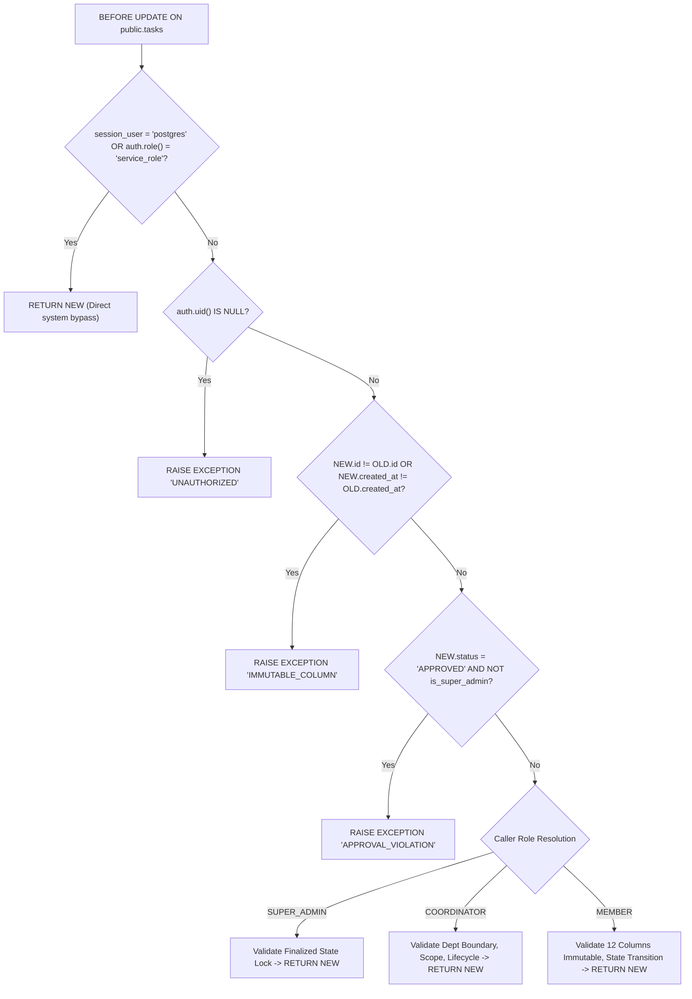

# UEC ESPACE DIGITAL — PHASE 2.4.1 TRIGGER INTERACTION ANALYSIS
## Execution Ordering, Coexistence & Architectural Design for `public.tasks` Triggers

**Project:** UEC — Espace Digital (*Union des Étudiants Clubistes*)  
**Database:** PostgreSQL 17.12 (`aigsdarfiplwmzqtqlxh`)  
**Target Table:** `public.tasks`  
**Date:** 2026-11-21  
**Status:** **TECHNICAL ARCHITECTURAL ANALYSIS**

---

## 1. PostgreSQL Trigger Execution Mechanics

In PostgreSQL, when multiple `BEFORE UPDATE` triggers are attached to the same table, the PostgreSQL engine executes them sequentially according to their **trigger names in alphabetical order (ASCII sort order)**.

Each trigger in the chain receives the `OLD` row (as stored on disk) and the `NEW` row (possibly modified by a preceding trigger in the execution chain). If any trigger raises an exception (`RAISE EXCEPTION`), the entire transaction is rolled back immediately, and subsequent triggers do not execute.

---

## 2. Inventory of Current Triggers on `public.tasks`

The live database catalog query on `aigsdarfiplwmzqtqlxh` reveals two existing triggers on `public.tasks`:

| Trigger Name | Event & Timing | Target Function | Purpose |
|---|---|---|---|
| `trg_enforce_task_approval` | `BEFORE UPDATE FOR EACH ROW` | `private.enforce_super_admin_approval()` | Rejects `NEW.status = 'APPROVED'` if caller is not Super Admin |
| `trg_set_updated_at` | `BEFORE UPDATE FOR EACH ROW` | `public.set_updated_at()` | Automatically sets `NEW.updated_at = now()` |

### Source of `private.enforce_super_admin_approval()`:
```sql
BEGIN
  IF current_user IN ('postgres', 'service_role', 'supabase_admin') AND auth.uid() IS NULL THEN
    RETURN NEW;
  END IF;

  IF TG_TABLE_NAME = 'task_submissions' THEN
    -- Submission approval logic...
  END IF;

  IF TG_TABLE_NAME = 'tasks' THEN
    IF NEW.status = 'APPROVED' AND (OLD.status IS NULL OR OLD.status <> 'APPROVED') THEN
      IF NOT private.is_super_admin(auth.uid()) THEN
        RAISE EXCEPTION 'APPROVAL_VIOLATION: Seul le Super Admin peut valider une tâche au statut APPROVED.';
      END IF;
    END IF;
  END IF;

  RETURN NEW;
END;
```

---

## 3. Analysis of Alphabetical Trigger Ordering

When we introduce the immutability trigger for SEC-V01, naming determines execution order:

### Scenario A: Naming as `trg_enforce_task_member_immutability`
1. **Trigger 1:** `trg_enforce_task_approval` ('a' comes before 'm')
2. **Trigger 2:** `trg_enforce_task_member_immutability` ('m' comes before 's')
3. **Trigger 3:** `trg_set_updated_at` ('s')

#### Execution Dynamics in Scenario A:
- If a non-admin attempts to set `status = 'APPROVED'`, Trigger 1 fires first and raises `APPROVAL_VIOLATION`. The transaction terminates before Trigger 2 runs.
- If a member attempts to update `priority = 'URGENT'`, Trigger 1 evaluates `NEW.status = 'APPROVED'` (which is false) and returns `NEW`. Then Trigger 2 fires, detects that `priority` was mutated by a member, and raises `FORBIDDEN`.
- When Trigger 2 evaluates column changes, it compares `NEW.updated_at` vs `OLD.updated_at`. Because Trigger 3 (`trg_set_updated_at`) has not yet executed, `NEW.updated_at` has not been overwritten by `now()`. If a caller explicitly included `updated_at` in their REST payload, Trigger 2 can detect it; otherwise `NEW.updated_at` matches `OLD.updated_at`.
- Finally, Trigger 3 sets `NEW.updated_at = now()`.

### Scenario B: Naming as `trg_tasks_governance` (or after `trg_set_updated_at`)
If the immutability trigger were named `trg_validate_tasks`:
- Trigger 3 (`trg_set_updated_at`) would fire **before** `trg_validate_tasks`!
- Consequently, `NEW.updated_at` would already be set to `now()` by the database engine!
- If the immutability trigger compared `IF NEW.updated_at IS DISTINCT FROM OLD.updated_at`, it would **always evaluate to true**, erroneously rejecting legitimate updates!

---

## 4. Architectural Alternatives: Separate vs. Consolidated Triggers

Two viable architectures exist for structuring these safeguards:

### Pattern 1: Separate Modular Triggers with Explicit Sequence Prefix
- `trg_01_tasks_enforce_approval` -> `private.enforce_super_admin_approval()`
- `trg_02_tasks_enforce_immutability` -> `private.enforce_task_member_immutability()`
- `trg_99_tasks_set_updated_at` -> `public.set_updated_at()`

**Pros:**
- Complete separation of concerns: approval workflow vs field immutability vs timestamps.
- Zero modifications to `private.enforce_super_admin_approval()`, which is also used by `task_submissions`.
- Easy independent enable/disable during maintenance.

**Cons:**
- Relies on name prefixing conventions to guarantee execution sequence.
- Multiple function calls per row update (slight microsecond overhead).

---

### Pattern 2: Consolidated Task Update Governance Trigger
A single unified trigger function: `private.enforce_task_update_governance()` that encapsulates:
1. System/Service-role bypass check.
2. Universal immutability of `id` and `created_at`.
3. Super Admin authorization check for `NEW.status = 'APPROVED'`.
4. Role-based immutability and state machine validation.
5. Setting `NEW.updated_at = now()`.



**Pros:**
- Single atomic point of governance for the entire `tasks` update lifecycle.
- Deterministic, consolidated logic with zero reliance on alphabetical trigger naming order.
- Fixes the `SECURITY DEFINER` identity confusion flaw in both approval and immutability checks simultaneously.
- Eliminates redundant role lookups (`private.is_super_admin()` called once instead of twice).

**Cons:**
- Requires careful migration from existing `trg_enforce_task_approval`. Note: `trg_enforce_submission_approval` on `task_submissions` remains intact.

---

## 5. Architectural Recommendation

**Pattern 2 (Consolidated Governance Trigger)** is technically superior, safer, and cleaner.  
However, to maintain absolute non-disruptive backward compatibility with the existing migration history and tests (which specifically verify `trg_enforce_task_approval`), the recommended Phase 2.4 deployment strategy is:

1. Deploy the refined `private.enforce_task_member_immutability()` as `trg_enforce_task_member_immutability`.
2. Alphabetical ordering naturally places it between `trg_enforce_task_approval` ('a') and `trg_set_updated_at` ('s').
3. Both triggers execute harmoniously:
   - Approval enforcement operates independently on `APPROVED`.
   - Immutability enforcement validates columns and member state transitions.
   - Timestamp trigger updates `updated_at` last.
4. If a consolidated trigger is preferred in future database refactoring, Pattern 2 provides the exact tested architecture.
