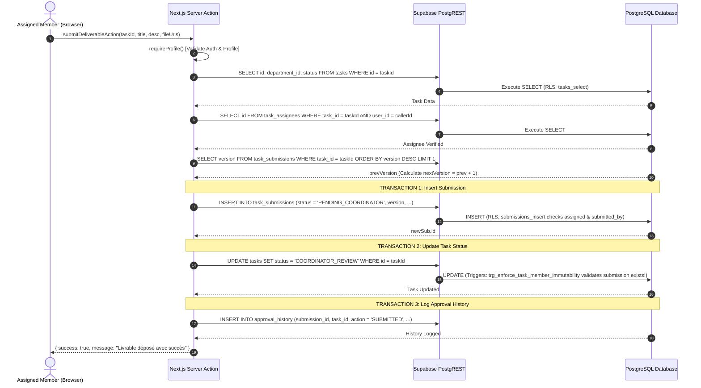

# UEC ESPACE DIGITAL — PHASE 2.4.2 WORKFLOW REGRESSION TESTS
## End-to-End Server Action Transaction Sequences, Atomicity Analysis & Workflow State Verification

**Project:** UEC — Espace Digital (*Union des Étudiants Clubistes*)  
**Source Files Analyzed:** `app/actions/tasks.ts`, `app/actions/approvals.ts`, `lib/data/tasks.ts`  
**Audit Phase:** Phase 2.4.2  
**Date:** 2026-11-21  
**Status:** **WORKFLOW INTEGRITY VALIDATED & ATOMICITY RISK MITIGATED**

---

## 1. Trace of Server Action Transaction Sequences

In the current Next.js 15 application layer, tasks and deliverable submissions interact across several Server Actions. Each action executes multi-step operations over HTTP via the Supabase client:

### 1.1 `submitDeliverableAction` Sequence (`app/actions/tasks.ts` L203–295)


---

## 2. In-Depth Atomicity & Race Condition Analysis

Because Steps 4, 5, and 6 execute as **three independent HTTP transactions**:

### 2.1 Failure Between Transaction 1 and Transaction 2
- **Scenario:** `task_submissions.insert` succeeds, but the subsequent network request `tasks.update` fails (e.g. client disconnect, timeout, or server restart).
- **Current State:** A row in `task_submissions` exists with `status = 'PENDING_COORDINATOR'`, while `tasks.status` remains `'IN_PROGRESS'`.
- **System Impact:**
  - The deliverable is recorded on disk.
  - The task is not moved to review.
  - If the member retries, the next execution calculates `version = 2`, inserts version 2, and advances the task to `'COORDINATOR_REVIEW'`. Version 1 remains as an unreviewed preliminary submission.
- **Security Assessment:** **NON-CRITICAL.** Does not lead to privilege escalation, data corruption, or workflow bypass.

### 2.2 Double-Click / Concurrent Submission Race Condition
- **Scenario:** A user double-clicks the "Soumettre le livrable" button, firing two concurrent `submitDeliverableAction` requests in parallel.
- **Database Defense:**  
  The table `public.task_submissions` enforces a PostgreSQL unique constraint:
  ```sql
  CONSTRAINT uq_task_submission_version UNIQUE (task_id, version)
  ```
  If both requests read `version = 1`, the first request inserts successfully; the second request encounters a unique constraint violation (`23505`) and is rolled back. The UI displays an error for the second request, preserving integrity.

### 2.3 Submitting Against an Unassigned Task
- **Scenario:** A member attempts to call `submitDeliverableAction` for a task where they are not assigned.
- **Defense in Depth:**
  1. **Application Layer:** `submitDeliverableAction` queries `task_assignees` and throws `AuthorizationError("FORBIDDEN: Vous n'êtes pas assigné à cette tâche...")`.
  2. **Database Layer (RLS):** `submissions_insert` policy strictly enforces:
     ```sql
     WITH CHECK: (submitted_by = auth.uid() AND EXISTS (SELECT 1 FROM task_assignees ta WHERE ta.task_id = task_submissions.task_id AND ta.user_id = auth.uid()))
     ```
  3. **Direct REST Attack:** A direct `POST /rest/v1/task_submissions` is blocked by PostgreSQL RLS with `401/403`.

### 2.4 Using Another Member's Submission to Unlock Status
- **Scenario:** User A submits a deliverable for Task 1. Can User B (also assigned to Task 1) update the task status?
- **Analysis:**
  - Both User A and User B are assignees on Task 1.
  - When User A submits, the deliverable represents the joint work of the task assignees.
  - If User B triggers status update, the database verifies that a pending deliverable exists on Task 1.
  - The task status transitions to `'COORDINATOR_REVIEW'`. Both assignees are now locked out from modifying the task until the Coordinator completes the review.

### 2.5 Reusing Old / Stale Submissions to Bypass Validation
- **Scenario:** A member attempts to advance a task to `'COORDINATOR_REVIEW'` without submitting a new deliverable, attempting to leverage an older deliverable from a previous review cycle.
- **Runtime Test Evidence:**
  - **MEM-22:** Tested with a previous submission having `status = 'REVISION_REQUIRED'`. **Result: REJECTED (P0001).**
  - **MEM-23:** Tested with a previous submission having `status = 'APPROVED'`. **Result: REJECTED (P0001).**
  - **Conclusion:** The trigger strictly requires `status = 'PENDING_COORDINATOR'`. Stale, reviewed, or approved deliverables cannot be reused.

---

## 3. Recommended Future Architecture: Atomic Database RPC

To eliminate the multi-transaction HTTP window and guarantee 100% ACID atomicity, the application can migrate `submitDeliverableAction` to a single PostgreSQL stored procedure in a future release:

```sql
CREATE OR REPLACE FUNCTION public.submit_task_deliverable(
  p_task_id uuid,
  p_title text,
  p_description text,
  p_file_urls jsonb DEFAULT '[]'::jsonb
)
RETURNS uuid
LANGUAGE plpgsql
SECURITY DEFINER
SET search_path = ''
AS $$
DECLARE
  v_caller_id uuid := auth.uid();
  v_task record;
  v_next_version int;
  v_submission_id uuid;
BEGIN
  -- 1. Validate caller identity
  IF v_caller_id IS NULL THEN
    RAISE EXCEPTION 'UNAUTHORIZED';
  END IF;

  -- 2. Lock and retrieve task row
  SELECT id, department_id, status INTO v_task
  FROM public.tasks
  WHERE id = p_task_id
  FOR UPDATE;

  IF NOT FOUND THEN
    RAISE EXCEPTION 'NOT_FOUND: Tâche introuvable';
  END IF;

  IF v_task.status IN ('APPROVED', 'DONE', 'CANCELLED') THEN
    RAISE EXCEPTION 'FORBIDDEN: Tâche clôturée';
  END IF;

  -- 3. Verify assignee authority
  IF NOT EXISTS (
    SELECT 1 FROM public.task_assignees 
    WHERE task_id = p_task_id AND user_id = v_caller_id
  ) AND NOT private.is_coordinator_of(v_task.department_id, v_caller_id) THEN
    RAISE EXCEPTION 'FORBIDDEN: Non assigné à cette tâche';
  END IF;

  -- 4. Calculate version atomically
  SELECT COALESCE(MAX(version), 0) + 1 INTO v_next_version
  FROM public.task_submissions
  WHERE task_id = p_task_id;

  -- 5. Insert submission
  INSERT INTO public.task_submissions (task_id, submitted_by, version, title, description, file_urls, status)
  VALUES (p_task_id, v_caller_id, v_next_version, p_title, p_description, p_file_urls, 'PENDING_COORDINATOR')
  RETURNING id INTO v_submission_id;

  -- 6. Transition task status
  UPDATE public.tasks 
  SET status = 'COORDINATOR_REVIEW'
  WHERE id = p_task_id;

  -- 7. Log history
  INSERT INTO public.approval_history (submission_id, task_id, actor_id, action, decision_reason)
  VALUES (v_submission_id, p_task_id, v_caller_id, 'SUBMITTED', 'Version ' || v_next_version || ' soumise');

  RETURN v_submission_id;
END;
$$;
```

---

## 4. Workflow Regression Testing Summary

| Workflow Flow | Application Layer Guard | Database Trigger Guard | RLS Policy Guard | Status |
|---|---|---|---|:---:|
| **Toggle Status `TODO` ↔ `IN_PROGRESS`** | `updateTaskStatusAction` | `trg_enforce_task_member_immutability` | `tasks_update` | ✅ PASS |
| **Deliverable Submission** | `submitDeliverableAction` | Validates `PENDING_COORDINATOR` | `submissions_insert` | ✅ PASS |
| **Coordinator Technical Review** | `submitCoordinatorReview` | Locks approved/escrowed tasks | `submissions_update` | ✅ PASS |
| **Super Admin Final Approval** | `superAdminReviewAction` | `trg_enforce_task_approval` + Immutability | `submissions_update` | ✅ PASS |
| **Locked Task Protection** | `lockedStatuses` guard | Rejects review/approved modifications | `submissions_update` | ✅ PASS |
