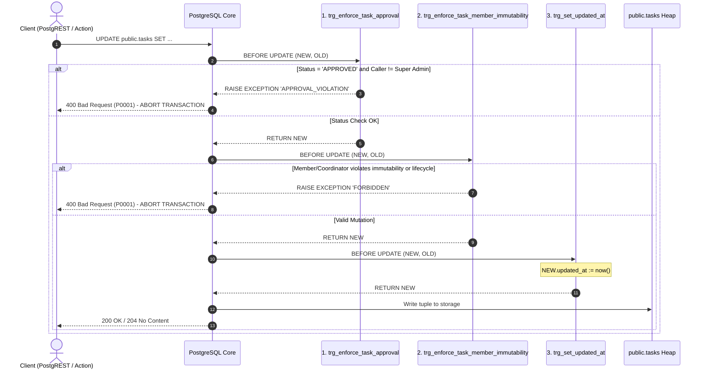

# UEC ESPACE DIGITAL — PHASE 2.4.4.1
## PostgreSQL Trigger Order & Interaction Verification

**Project:** UEC — Espace Digital (*Union des Étudiants Clubistes — Depuis 2021*)  
**Repository:** `rayenmkadmini/uec`  
**Branch:** `feature/uec-espace-digital`  
**Target Table:** `public.tasks`  
**Database Engine:** PostgreSQL 17.12 (Supabase)

---

### 1. PostgreSQL Trigger Firing Specification

According to the official PostgreSQL Documentation (*Chapter 39: Triggers*):
> *"If multiple triggers of the same kind are defined for the same event, they will be fired in alphabetical order by name."*

On `public.tasks`, all three evaluated triggers share identical characteristics:
- **Event:** `UPDATE`
- **Timing:** `BEFORE`
- **Granularity:** `FOR EACH ROW`

Therefore, execution order is determined strictly by the lexicographical order of their trigger names (`ASCII` collation):

```
1. 'trg_enforce_task_approval'            (Function: private.enforce_super_admin_approval)
2. 'trg_enforce_task_member_immutability' (Function: private.enforce_task_member_immutability)
3. 'trg_set_updated_at'                   (Function: public.set_updated_at)
```

Alphabetical Proof:
- Character 18: `'a'` (`trg_enforce_task_a...`) < `'m'` (`trg_enforce_task_m...`)  
  -> `trg_enforce_task_approval` executes **FIRST**.
- Character 18: `'m'` (`trg_enforce_task_m...`) < `'s'` (`trg_s...`)  
  -> `trg_enforce_task_member_immutability` executes **SECOND**.
- Downstream: `trg_set_updated_at` executes **THIRD**.

---

### 2. Interaction & Execution Flow Analysis



---

### 3. Adversarial Interaction Scenarios

#### Scenario A: Member attempts to set `status = 'APPROVED'` directly
1. `trg_enforce_task_approval` fires first.
2. It detects `NEW.status = 'APPROVED'` and `NOT private.is_super_admin(auth.uid())`.
3. It raises `APPROVAL_VIOLATION`.
4. Transaction aborts immediately. `trg_enforce_task_member_immutability` and `trg_set_updated_at` never execute.

#### Scenario B: Member attempts to mutate `title` while keeping `status = 'TODO'`
1. `trg_enforce_task_approval` fires first: status is not changing to `'APPROVED'`, so it returns `NEW`.
2. `trg_enforce_task_member_immutability` fires second: detects `NEW.title IS DISTINCT FROM OLD.title` from a regular member.
3. It raises `FORBIDDEN`.
4. Transaction aborts immediately. `trg_set_updated_at` never executes, preventing phantom timestamp bumps.

#### Scenario C: Member legitimately advances task `TODO -> IN_PROGRESS`
1. `trg_enforce_task_approval` fires first: status is `'IN_PROGRESS'`, returns `NEW`.
2. `trg_enforce_task_member_immutability` fires second: verifies assignment, confirms zero structural fields changed, verifies `IN_PROGRESS` is permitted, returns `NEW`.
3. `trg_set_updated_at` fires third: sets `NEW.updated_at = now()`.
4. Tuple is persisted with updated status and updated timestamp.

---

### 4. Verdict on Trigger Order & Interaction

- **Order Correctness:** The alphabetical execution sequence `Approval Guard -> Immutability Validator -> Timestamp Updater` is mathematically and architecturally optimal.
- **Fail-Fast Efficiency:** Validation errors fail fast before timestamp calculation or heap writes occur.
- **Side-Effect Free:** Aborted updates leave zero traces and touch zero timestamps.
- **Zero Trigger Conflicts:** Neither trigger alters data in a way that conflicts with downstream triggers.
