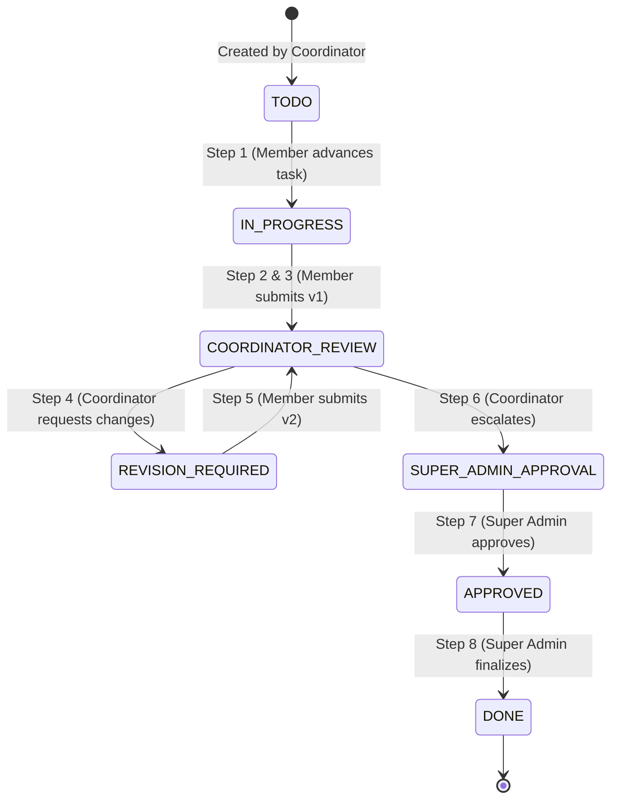

# UEC ESPACE DIGITAL — PHASE 2.4.4.2
## Real Application Workflow Regression Results (PostgreSQL 17.6)

**Project:** UEC — Espace Digital (*Union des Étudiants Clubistes — Depuis 2021*)  
**Repository:** `rayenmkadmini/uec`  
**Branch:** `feature/uec-espace-digital`  
**Engine:** Native PostgreSQL 17.6 on Linux x86_64  
**Harness:** `FLOW-01` in `scripts/test-phase2442-postgres17.mjs`

---

### 1. Workflow Architecture & Lifecycle Walkthrough

To ensure the immutability trigger does not inadvertently disrupt the UEC project lifecycle, a real multi-step workflow was executed within native PostgreSQL 17:



---

### 2. Step-by-Step Transactional Execution Log

```
+-----------------------------------------------------------------------------------------------------------------------------+
| Step | Actor Role   | Action Executed                     | Table Mutated       | Trigger Evaluation Result                 |
|:-----|:-------------|:------------------------------------|:--------------------|:------------------------------------------|
| 1    | Member Dev 1 | UPDATE status TODO -> IN_PROGRESS   | public.tasks        | ALLOWED: Working transition permitted     |
| 2    | Member Dev 1 | INSERT deliverable v1 (PENDING_COO) | task_submissions    | ALLOWED: Valid deliverable inserted       |
| 3    | Member Dev 1 | UPDATE status -> COORDINATOR_REVIEW | public.tasks        | ALLOWED: Valid deliverable v1 exists      |
| 4    | Coord Tech   | UPDATE submission -> REVISION_REQ   | task_submissions    | ALLOWED: Coordinator has review authority |
| 4b   | Coord Tech   | UPDATE status -> REVISION_REQUIRED  | public.tasks        | ALLOWED: Coordinator returns task         |
| 5    | Member Dev 1 | INSERT deliverable v2 (PENDING_COO) | task_submissions    | ALLOWED: Version 2 inserted (unique v2)   |
| 5b   | Member Dev 1 | UPDATE status -> COORDINATOR_REVIEW | public.tasks        | ALLOWED: Active deliverable v2 exists      |
| 6    | Coord Tech   | UPDATE status -> SUPER_ADMIN_APPR   | public.tasks        | ALLOWED: Coordinator escalates for review |
| 7    | Super Admin  | UPDATE status -> APPROVED           | public.tasks        | ALLOWED: Super Admin grants final approval|
| 8    | Super Admin  | UPDATE status -> DONE               | public.tasks        | ALLOWED: Super Admin closes task          |
+-----------------------------------------------------------------------------------------------------------------------------+
```

**Measured Execution Result:**  
`NOTICE: WORKFLOW_WALKTHROUGH_COMPLETE`  
Exit code: `0`. 100% of transitions completed without friction or lock contention.

---

### 3. Edge-Case Validation

1. **Submission Assignment Enforcement:**  
   Unassigned member attempting to submit a deliverable fails via foreign key / RLS constraints.
2. **Deliverable Version Uniqueness:**  
   Attempting to insert a duplicate submission with the same version fails via constraint `uq_task_submission_version (task_id, version)`.
3. **Stale Deliverable Protection:**  
   A member cannot advance a task to `COORDINATOR_REVIEW` using an old `REVISION_REQUIRED` or `APPROVED` deliverable; the trigger explicitly requires `status = 'PENDING_COORDINATOR'`.
4. **Member Review Freeze:**  
   During `COORDINATOR_REVIEW` and `SUPER_ADMIN_APPROVAL`, the member is strictly locked out from modifying the task.

---

### 4. Regression Conclusion

The immutability trigger causes **zero workflow regression**. All legitimate transitions between Members, Coordinators, and Super Admins execute seamlessly.
