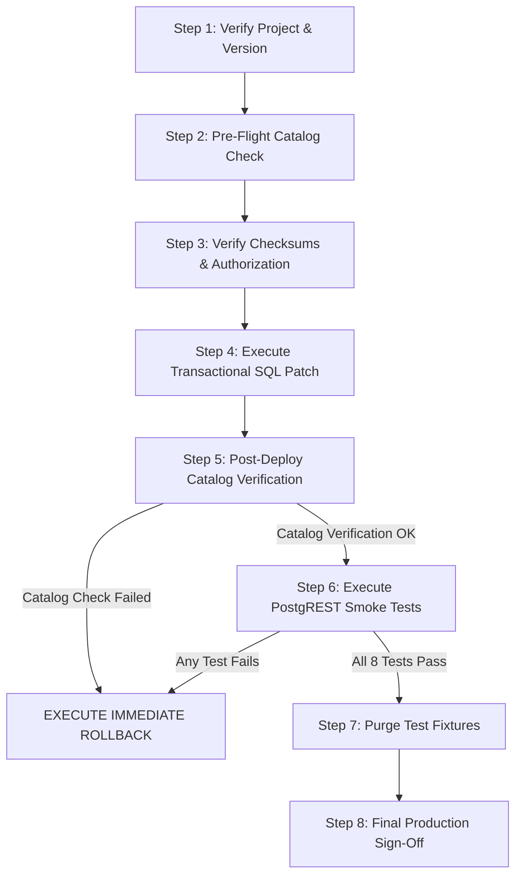

# UEC ESPACE DIGITAL — PHASE 2.4.4
## Production Deployment Runbook & Operational SOP

**Project:** UEC — Espace Digital (*Union des Étudiants Clubistes — Depuis 2021*)  
**Repository:** `rayenmkadmini/uec`  
**Branch:** `feature/uec-espace-digital`  
**Target Supabase Project:** `aigsdarfiplwmzqtqlxh`  
**Execution Target:** Database Engine PostgreSQL 17.12 (`eu-west-1`)  
**Deployment Scope:** Remediation of SEC-V01 (Column-Level Mutation Surface on `public.tasks`)  
**Status:** **READY FOR AUTHORIZATION — PENDING USER GO-AHEAD**

---

### 1. Pre-Deployment Prerequisites

Prior to commencing live execution, the operator must verify each of the following prerequisites:

- [ ] Target repository is clean on branch `feature/uec-espace-digital`.
- [ ] Working tree has no uncommitted changes.
- [ ] TypeScript compilation succeeds with zero errors (`npx tsc --noEmit`).
- [ ] ESLint passes with zero warnings (`npm run lint`).
- [ ] Next.js production build completes cleanly (`npm run build`).
- [ ] Automated security verification suite passes (`node scripts/verify-security.mjs`).
- [ ] Automated PostgreSQL isolated runtime tests pass (`node scripts/test-phase242-isolated.mjs`).
- [ ] SHA-256 of `docs/sql/PHASE_2_4_4_PRODUCTION_PATCH.sql` matches:
  `D23367632C85BA0D5F845E76BCE053FB02B471FD55E4F6FF93032524676DE75A`
- [ ] SHA-256 of `docs/sql/PHASE_2_4_4_PRODUCTION_ROLLBACK.sql` matches:
  `599EA4246FB357543731822CF744F82F34EC1D0322CDD15B30A42DCCAADA5649`
- [ ] **EXPLICIT USER AUTHORIZATION RECEIVED IN WRITING FOR PROJECT `aigsdarfiplwmzqtqlxh`.**

---

### 2. Step-by-Step Deployment Procedure



#### Step 1: Project Identity & Version Verification
Run via Supabase SQL connection:
```sql
SELECT current_database(), version();
```
*Pass Criteria:* Database belongs to project `aigsdarfiplwmzqtqlxh`, engine contains `PostgreSQL 17.12`.

#### Step 2: Pre-Flight Catalog Sanity Check
Inspect existing triggers on `public.tasks`:
```sql
SELECT tgname, tgenabled FROM pg_trigger WHERE tgrelid = 'public.tasks'::regclass AND NOT tgisinternal;
```
*Pass Criteria:* Exactly 2 triggers returned: `trg_enforce_task_approval` and `trg_set_updated_at`.

#### Step 3: Checksum & File Validation
Verify local file hashes match:
```powershell
Get-FileHash docs/sql/PHASE_2_4_4_PRODUCTION_PATCH.sql -Algorithm SHA256
```

#### Step 4: Execute Transactional Production Patch
Execute the exact content of [docs/sql/PHASE_2_4_4_PRODUCTION_PATCH.sql](file:///d:/uecdegital/docs/sql/PHASE_2_4_4_PRODUCTION_PATCH.sql) in a single transaction block.

*Expected Execution Output:*
- Notice: `PRECONDITIONS_PASSED: Project aigsdarfiplwmzqtqlxh catalog verified for Phase 2.4.4 deployment.`
- Function `private.enforce_task_member_immutability()` created.
- Privileges granted to `postgres, service_role, authenticated`.
- Trigger `trg_enforce_task_member_immutability` created.
- Transaction `COMMIT` completed in < 250ms.

#### Step 5: Post-Deployment Catalog Verification
Immediately execute the read-only catalog verification queries:
```sql
-- 5.1 Trigger list and ordering
SELECT t.tgname, p.proname, n.nspname 
FROM pg_trigger t
JOIN pg_proc p ON t.tgfoid = p.oid
JOIN pg_namespace n ON p.pronamespace = n.oid
WHERE t.tgrelid = 'public.tasks'::regclass AND NOT t.tgisinternal
ORDER BY t.tgname;
```
*Pass Criteria:* Exactly 3 triggers returned in alphabetical order:
1. `trg_enforce_task_approval`
2. `trg_enforce_task_member_immutability`
3. `trg_set_updated_at`

```sql
-- 5.2 Security Definer and search_path verification
SELECT proname, prosecdef, proconfig, r.rolname AS owner
FROM pg_proc p
JOIN pg_roles r ON p.proowner = r.oid
WHERE proname = 'enforce_task_member_immutability';
```
*Pass Criteria:* `prosecdef = true`, `proconfig = {search_path=}`, `owner = postgres`.

```sql
-- 5.3 Execution Privileges
SELECT grantee, privilege_type 
FROM information_schema.routine_privileges 
WHERE specific_schema = 'private' AND routine_name = 'enforce_task_member_immutability';
```
*Pass Criteria:* Grants exist ONLY for `postgres`, `service_role`, `authenticated`. Zero grants for `anon` or `PUBLIC`.

#### Step 6: PostgREST Gateway Smoke Tests
Execute the 8 scenarios specified in [docs/PHASE_2_4_4_POSTGREST_SMOKE_TEST_PLAN.md](file:///d:/uecdegital/docs/PHASE_2_4_4_POSTGREST_SMOKE_TEST_PLAN.md) using disposable test fixtures.
*Pass Criteria:* 8/8 tests pass with expected HTTP codes (`200`/`204` on legitimate workflows, `400 P0001` on unauthorized mutations).

#### Step 7: Teardown Disposable Smoke Fixtures
Execute teardown SQL to remove all `SMOKE_P244_` test records.

#### Step 8: Final Sign-Off & Phase Transition
Document results in `PHASE_2_4_5_PRODUCTION_EXECUTION_REPORT.md` and transition to Phase 2.5.

---

### 3. Failure Handling & Abort Thresholds

If ANY step fails, follow these strict rules:

| Failure Mode | Trigger Point | Immediate Action |
|:---|:---|:---|
| Precondition exception | Step 4 | Transaction aborts automatically; report reason to user; DO NOT force execution |
| Catalog verification failure | Step 5 | Execute `PHASE_2_4_4_PRODUCTION_ROLLBACK.sql` immediately; notify user |
| PostgREST HTTP 500 error | Step 6 | Stop smoke tests; execute `PHASE_2_4_4_PRODUCTION_ROLLBACK.sql` |
| Legitimate member lockout | Step 6 (SMK-02) | Execute rollback immediately |
| Unexpected locking / deadlock | Any step | Terminate conflicting session; execute rollback |
