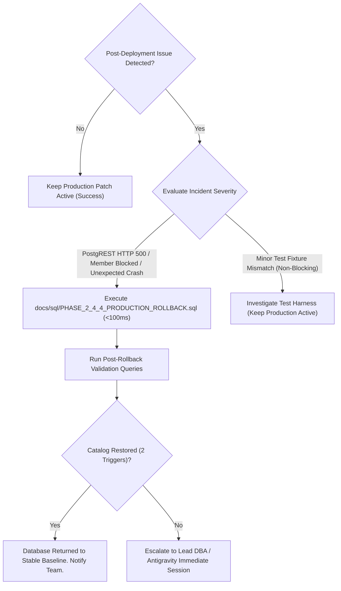

# UEC ESPACE DIGITAL — PHASE 2.4.4
## Rollback, Disaster Recovery & Fail-Safe Specification

**Project:** UEC — Espace Digital (*Union des Étudiants Clubistes — Depuis 2021*)  
**Repository:** `rayenmkadmini/uec`  
**Branch:** `feature/uec-espace-digital`  
**Target Supabase Project:** `aigsdarfiplwmzqtqlxh`  
**Authoritative Rollback Script:** [docs/sql/PHASE_2_4_4_PRODUCTION_ROLLBACK.sql](file:///d:/uecdegital/docs/sql/PHASE_2_4_4_PRODUCTION_ROLLBACK.sql)  
**Rollback SHA-256:** `599EA4246FB357543731822CF744F82F34EC1D0322CDD15B30A42DCCAADA5649`

---

### 1. Rollback Architecture & Non-Destructive Invariant

The rollback package is designed with zero blast radius:

1. **Transactional Atomicity:** In PostgreSQL, DDL commands (`DROP TRIGGER`, `DROP FUNCTION`) are fully transactional. Wrapping the rollback in `BEGIN; ... COMMIT;` ensures that either both objects are dropped completely or the database state remains unchanged.
2. **Table & Data Neutrality:** The patch creates no tables, adds no columns, and modifies zero existing rows. Dropping the trigger and function restores the exact schema state of Phase 2.3/Phase 2.3.1 without risking any data corruption or data loss.
3. **Trigger Independence:** The rollback specifies only `trg_enforce_task_member_immutability` and `private.enforce_task_member_immutability()`. Pre-existing triggers (`trg_enforce_task_approval`, `trg_set_updated_at`) and existing private functions (`is_super_admin`, `is_coordinator_of`) are completely untouched.
4. **Execution Speed:** The rollback script consists of two DDL statements executing in under **100 milliseconds** with minimal catalog lock duration.

---

### 2. Standby Rollback Script Specification

```sql
BEGIN;

-- 1. DROP TRIGGER SAFELY
DROP TRIGGER IF EXISTS trg_enforce_task_member_immutability ON public.tasks;

-- 2. DROP FUNCTION SAFELY
DROP FUNCTION IF EXISTS private.enforce_task_member_immutability();

COMMIT;
```

#### Post-Rollback Validation Queries:
```sql
-- 1. Confirm exactly two pre-existing triggers remain
SELECT tgname FROM pg_trigger WHERE tgrelid = 'public.tasks'::regclass AND NOT tgisinternal ORDER BY tgname;
-- Expected: trg_enforce_task_approval, trg_set_updated_at

-- 2. Confirm function is dropped
SELECT EXISTS (
    SELECT 1 FROM pg_proc p 
    JOIN pg_namespace n ON p.pronamespace = n.oid 
    WHERE n.nspname = 'private' AND p.proname = 'enforce_task_member_immutability'
) AS function_exists;
-- Expected: false
```

---

### 3. Recovery Decision Tree



---

### 4. Failure Mode Recovery Matrix

| Scenario | Impact | Recovery Action | Target Time |
|:---|:---|:---|:---:|
| Precondition check fails during patch execution | Patch aborts automatically; zero changes applied | Review precondition notice; check database connection; do not force | Immediate (0s) |
| PostgREST returns HTTP 500 on valid member updates | Legitimate workflow disrupted | Execute `PHASE_2_4_4_PRODUCTION_ROLLBACK.sql` via Supabase SQL connection | < 30 seconds |
| Legitimate Coordinator edit rejected by trigger | Coordinator cannot update task title/deadline | Execute rollback immediately; re-evaluate PL/pgSQL condition | < 30 seconds |
| Post-deployment catalog check shows altered triggers | Unexpected trigger dropped or disabled | Execute rollback immediately; inspect schema history | < 30 seconds |
| Script error halfway through patch execution | PostgreSQL rolls back entire transaction block | Database remains at clean baseline; investigate error log | Immediate (0s) |

---

### 5. Post-Rollback Operational Continuity

If a rollback is executed:
- The database returns instantaneously to the state validated at the end of Phase 2.3.
- All application features (Next.js dashboard, approvals, task views) remain operational.
- The SEC-V01 limitation remains documented as an accepted risk while an adjusted patch is reviewed in a subsequent phase.
